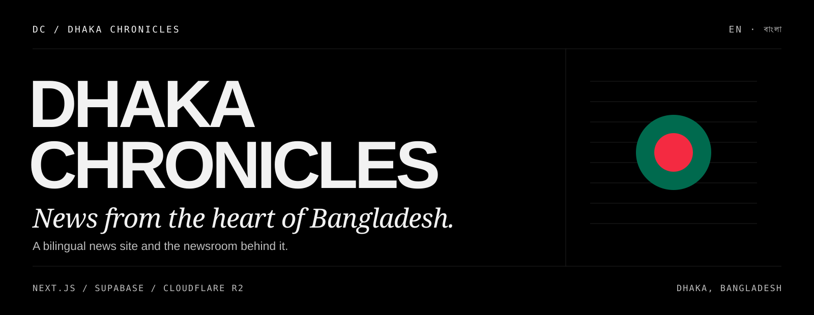
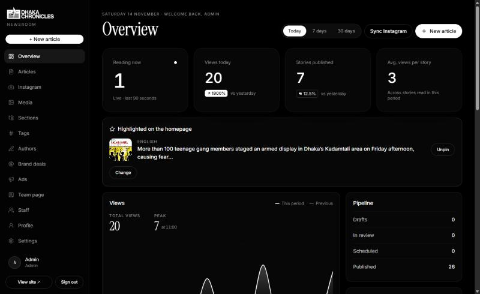
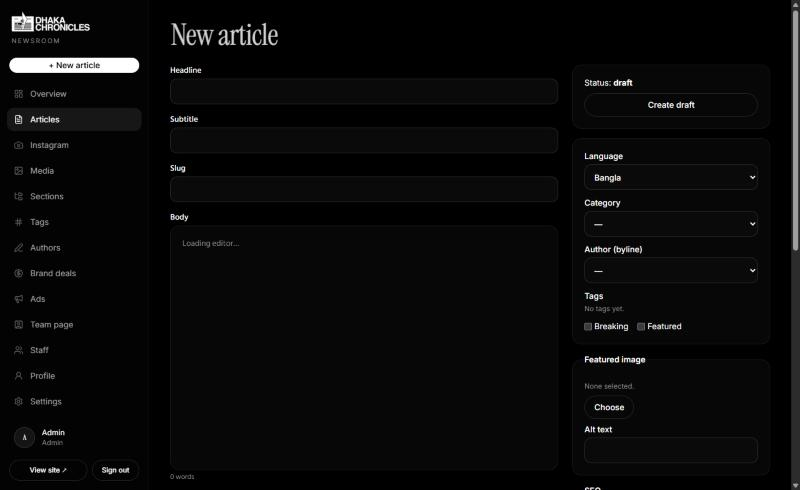

<div align="center">



# Dhaka Chronicles

**A bilingual news site, and the newsroom that runs it.**

English and Bangla editions, a full editorial workflow, Instagram imports, ads and brand deals.
One Next.js 16 app on Supabase and Cloudflare R2.

[](package.json)
[](package.json)
[](tsconfig.json)
[](supabase/migrations)
[](docs/R2_SETUP.md)
[](src/app/globals.css)

[Live site](https://dhakachronicles.com) · [The site](#the-site) · [The newsroom](#the-newsroom) · [Quick start](#quick-start) · [Architecture](#architecture) · [Deployment](#deployment)

</div>

---

## The site

Dhaka Chronicles reads like a paper: an all-black page, a serif headline voice, and hairline rules
between stories. English lives at `/en` and Bangla at `/bn`. Every story is its own row per language,
linked so readers can switch with one tap.

<table>
  <tr>
    <td width="66%"></td>
    <td width="34%"></td>
  </tr>
</table>

| Page | What readers get |
| :--- | :--- |
| **Homepage** | Lead story and Featured column, Latest grid, section blocks, Most read (3 days), Instagram band, labelled partner content, ads |
| **Article** | Byline, reading time, share bar, gallery and inline video, tags, the source Instagram post, related stories, "Report an error" |
| **Search** | Instant previews in the header as you type; an empty search shows the newest stories |
| **Sections · Tags · Authors · Latest** | One page each, in both languages, with RSS per edition |
| **Advertise** | Past brand work, five ad formats drawn to scale, and an enquiry form |
| **Ad reports** | A private link per ad with views, clicks and a daily chart for the advertiser |

Phones get a swipeable section bar, a compact menu and images sized for small screens.

## The newsroom

Staff sign in at `/login` and work in `/admin`.

<table>
  <tr>
    <td width="50%"></td>
    <td width="50%"></td>
  </tr>
</table>

| Area | What it does |
| :--- | :--- |
| **Overview** | Readers right now, a views chart, top stories, the review pipeline and team activity |
| **Articles** | Write, review, schedule and publish; revisions, bulk actions and one-click translation drafts |
| **Instagram** | Browse [@dhakachronicles](https://www.instagram.com/dhakachronicles/), pick posts, import them as drafts, approve, retry failures |
| **Media** | Upload, caption and reuse photos and video; files are optimised automatically |
| **Sections · Tags · Authors** | Taxonomy and bylines; most sections and tags are filled in automatically |
| **Brand deals · Ads** | Sponsorship pipeline with fees and invoices, banner ads in three sizes with reports |
| **Staff · Team page** | Invite or create accounts, set roles, reset passwords, delete accounts, edit the public team page |
| **Settings** | Site name, logo, SEO defaults, social links, Discord channels and Instagram import mode |

Every important action is audited and posted to Discord. A full walkthrough with screenshots is in the
[newsroom guide](docs/guide/README.md).

## Quick start

Use **Node.js 20 or newer** and npm. You need a Supabase project and a Cloudflare R2 bucket;
Instagram, Resend, Discord and an AI key are optional.

```bash
git clone https://github.com/Osayeidzaber/dhakachronicles.git
cd dhakachronicles
npm install
cp .env.example .env.local
npx supabase link --project-ref <ref>
npx supabase db push --remote
npm run provision-admin -- admin@dhakachronicles.com "Admin Name"
npm run dev
```

Open **[localhost:3000](http://localhost:3000)** and sign in at `/login`. Fill in `.env.local` yourself
and never commit it.

| Guide | Covers |
| :--- | :--- |
| [`SUPABASE_SETUP.md`](SUPABASE_SETUP.md) | Project, auth, Resend SMTP, the invite template, disabled sign-ups |
| [`docs/R2_SETUP.md`](docs/R2_SETUP.md) | Bucket, keys, public media domain, CORS |
| [`docs/INSTAGRAM_SETUP.md`](docs/INSTAGRAM_SETUP.md) | Meta app, login configuration, redirect URI, webhook |
| [`docs/DEPLOYMENT.md`](docs/DEPLOYMENT.md) | Vercel, environment, cron, domains |

<details>
<summary><strong>Environment variables</strong></summary>

<br>

Every variable is **server-only**; none uses `NEXT_PUBLIC_`. See [`.env.example`](.env.example).

| Variable | Needed for | Purpose |
| :--- | :--- | :--- |
| `SUPABASE_URL`, `SUPABASE_PUBLISHABLE_KEY`, `SUPABASE_SECRET_KEY` | Everything | Database and auth |
| `SITE_URL` | Production | Public origin for canonical URLs, sitemaps, email links and OAuth |
| `DEFAULT_LANGUAGE` | | `en` (default) or `bn` for `/` |
| `CRON_SECRET` | Production | Protects `/api/cron/*` (16+ characters) |
| `R2_ACCOUNT_ID`, `R2_ACCESS_KEY_ID`, `R2_SECRET_ACCESS_KEY`, `R2_BUCKET`, `R2_PUBLIC_BASE_URL` | Media | Uploads and image hosting |
| `INSTAGRAM_APP_ID`, `INSTAGRAM_APP_SECRET`, `INSTAGRAM_CONFIG_ID`, `INSTAGRAM_REDIRECT_URI`, `INSTAGRAM_EXPECTED_USERNAME`, `INSTAGRAM_WEBHOOK_VERIFY_TOKEN` | Instagram | Imports from @dhakachronicles |
| `TOKEN_ENCRYPTION_KEY` | Instagram | 32 random bytes (base64) to encrypt tokens |
| `DISCORD_ARTICLE_WEBHOOK_URL`, `DISCORD_ACTIVITY_WEBHOOK_URL`, `DISCORD_ALERTS_WEBHOOK_URL` | | Notifications |
| `AI_SEO_API_URL`, `AI_SEO_API_KEY`, `AI_SEO_MODEL` | | SEO suggestions and automatic translation |
| `OWNER_EMAILS` | | Comma-separated main admins |
| `RESEND_API_KEY`, `SMTP_SENDER_EMAIL` | Email | In `supabase/.env`, for `supabase config push` |

</details>

## Commands

| Command | What it does |
| :--- | :--- |
| `npm run dev` | Development server on port 3000 |
| `npm run build` · `npm start` | Production build and server |
| `npm run typecheck` · `npm run lint` | Static checks |
| `npm test` | Unit and database tests (Vitest + PGlite, no Docker) |
| `npm run provision-admin -- <email> "<name>"` | Create or promote an admin |
| `node --env-file=.env.local scripts/reset-password.mjs <email>` | Give a staff account a temporary password |

Run typecheck, lint, test and build before every release.

## Architecture

```
Reader's browser ──► Next.js on Vercel
                       ├─ Public pages     server-rendered, cached with ISR
                       ├─ /admin           server components + server actions
                       └─ /api/*           views, search, ads, media, Instagram, cron
                              │
                ┌─────────────┼───────────────┬────────────────┐
                ▼             ▼               ▼                ▼
           Supabase      Cloudflare R2     Instagram       Discord
         Postgres, RLS,   media + CDN      Graph API       webhooks
          Auth, Cron
```

- **One app.** Site, newsroom and API live in one Next.js project, with no separate servers.
- **Secrets stay on the server.** Supabase, R2, Instagram, Discord and AI keys are read through
  [`src/lib/env.ts`](src/lib/env.ts). The browser only holds an httpOnly session cookie.
- **Permissions are checked twice.** Server code checks the permission matrix, and Postgres RLS enforces
  the same rules again.
- **The public sees only safe data.** Fees, contacts and ad tokens are reachable only through
  `security definer` functions that return safe columns.
- **One row per language.** Translations share a `translation_group_id` and publish independently.
- **Fast by default.** ISR pages refresh on publish, images are pre-optimised AVIF/WebP from the CDN,
  and fonts are self-hosted.

| Layer | Choice |
| :--- | :--- |
| Framework | Next.js 16 App Router, React 19, TypeScript strict |
| Styling | Tailwind CSS v4 with design tokens in [`globals.css`](src/app/globals.css) |
| Data and auth | Supabase: Postgres, Row Level Security, Auth, Cron |
| Media | Cloudflare R2 behind `media.dhakachronicles.com`, optimised with Sharp |
| Editor | Tiptap 3, stored as JSON and rendered by our own component |
| Email | Resend, as Supabase Auth's SMTP |
| Validation · tests | Zod 4 · Vitest with PGlite |

<details>
<summary><strong>Roles and permissions</strong></summary>

<br>

| Permission | Writer | Editor | Admin | Main admin |
| :--- | :-: | :-: | :-: | :-: |
| Write articles | Own drafts | ✓ | ✓ | ✓ |
| Edit anyone's articles, publish, schedule | | ✓ | ✓ | ✓ |
| Delete articles | | | ✓ | ✓ |
| Upload media | ✓ | ✓ | ✓ | ✓ |
| Sections, tags, authors, brand deals, ads | | ✓ | ✓ | ✓ |
| Team page, staff roles, settings, audit log | | | ✓ | ✓ |
| Manage Instagram | | | | ✓ |
| Reset passwords, delete accounts | | | | ✓ |

Main admins are `admin@zaber.tech` and `admin@dhakachronicles.com` (override with `OWNER_EMAILS`).
Nobody can change, reset or delete a main admin. Sign-ups are disabled; staff join by invite.

</details>

<details>
<summary><strong>Article workflow</strong></summary>

<br>

```
           submit              approve / publish
 draft ───────────► pending_review ─────────────► published
   ▲   ◄─────────────┘ return_to_draft                │
   │                                                  │ unpublish
   │          schedule (date/time)                    ▼
   └──────────────────────────────► scheduled ──► published (cron, every minute)
 archive ◄── any state ── restore ──► draft
```

Writers submit for review; editors and admins publish or schedule. The state machine lives in
[`workflow.ts`](src/lib/articles/workflow.ts) and is enforced again in SQL. Revisions are saved before
big edits, and publishing refreshes the affected pages, sitemaps and RSS.

</details>

<details>
<summary><strong>Instagram import</strong></summary>

<br>

1. A main admin connects @dhakachronicles once. The token is encrypted (AES-256-GCM) and refreshed before it expires.
2. Pick posts from the feed and import them as drafts, or import and publish in one step.
3. Each post becomes a draft: the caption's first sentence as the headline, the full caption as the body,
   photos and reels optimised, language detected, and a section and tags filled in automatically.
4. Collaborations and paid posts are tagged **Sponsored**.
5. Failed imports retry with growing gaps and can be retried by hand.
6. Every 15 minutes a sync refreshes likes and comments, re-ranks featured stories and, if enabled, brings in new posts.

Only the `dhakachronicles` account can be connected, and imports never publish themselves unless you choose to.

</details>

<details>
<summary><strong>Ads, brand deals and translation</strong></summary>

<br>

**Ads** have a link, a placement, dates and three image sizes, chosen per screen:

| Size | Pixels | Used on |
| :--- | :--- | :--- |
| Desktop banner | 1200 × 300 | Homepage, tablets and desktops |
| Phone banner | 640 × 320 | Homepage, phones |
| Square | 600 × 600 | Inside articles |

An impression counts when half the ad is on screen for a second; clicks go through a counting redirect.
Each ad has a private report link, and every ad is labelled with `rel="sponsored nofollow"`.

**Brand deals** move from lead to published, with fee, invoice and checklist. Brands can opt into the
public portfolio, which shows their logo and work but never fees or contacts. Advertise-page enquiries
arrive as new leads.

**Translation** turns any article into a draft in the other language through an OpenAI-compatible API,
keeping formatting, images, names, numbers and links. An editor reviews it before it goes live.

</details>

<details>
<summary><strong>Data model</strong></summary>

<br>

Every table has RLS turned on.

| Table | Holds |
| :--- | :--- |
| `profiles` | Staff name, role and avatar |
| `articles`, `article_revisions` | One row per language, content as Tiptap JSON, status, dates, SEO; snapshots |
| `categories`, `tags`, `authors` | Taxonomy and bylines in both languages |
| `media` | R2 key, URL, AVIF/WebP variants, alt text, caption, credit |
| `instagram_*` | Connection, imports, engagement and sync runs |
| `brand_deals`, `ads`, `ad_creatives`, `ad_stats` | Commercial pipeline, banners and their stats |
| `team_members` | The public team page |
| `site_settings`, `audit_log`, `notifications` | Settings, every staff action, in-app notices |

Schema changes are new files in [`supabase/migrations/`](supabase/migrations), each with tests in
[`tests/db.test.ts`](tests/db.test.ts).

</details>

## Repository layout

```text
src/
  app/[lang]/        Public site (en | bn): home, news, sections, search, advertise, RSS
  app/(cms)/         Login, set-password and the /admin newsroom
  app/api/           Views, search, ads, media uploads, Instagram, cron
  components/        Public, admin, content renderer and shared UI
  lib/               env, Supabase clients, auth, articles, Instagram, media, SEO, translation
supabase/            Migrations, invite email template, seed and cron
tests/               Vitest unit and database tests
scripts/             Admin provisioning and password reset
docs/                Setup guides, deployment and the newsroom guide
```

## Deployment

1. Create a Vercel project from this repository, add every environment variable and set `SITE_URL` to `https://dhakachronicles.com`.
2. In Supabase, set **Auth → URL Configuration → Site URL** to the same domain, add it to the redirect URLs, connect Resend as SMTP and keep sign-ups disabled.
3. Run `npx supabase db push --remote`, then run [`supabase/cron.sql`](supabase/cron.sql) in the SQL editor.
4. Point `media.dhakachronicles.com` at the R2 bucket and allow `PUT` from the site in its CORS rules.
5. Register the Instagram redirect URI and webhook, then connect the account in **Admin → Instagram**.

The full checklist is in [`docs/DEPLOYMENT.md`](docs/DEPLOYMENT.md).

<details>
<summary><strong>Troubleshooting</strong></summary>

<br>

| Symptom | Fix |
| :--- | :--- |
| Upload says "Failed to fetch" or "Upload to storage failed" | The R2 CORS rules don't allow the site's domain |
| Invite or reset email links to localhost | Supabase **Site URL** is still localhost |
| "Could not find the function … in the schema cache" | Run `npx supabase db push --remote` |
| `next/image` "hostname is not configured" | `R2_PUBLIC_BASE_URL` was missing at build time |
| Instagram "token expired" alert | A main admin clicks **Reconnect** on the Instagram page |
| Scheduled story didn't publish | `cron.sql` not run, or the Vault URL or secret is wrong |
| "Automatic translation is not set up" | Set the three `AI_SEO_*` variables |
| Ads not showing | Paused, outside its dates, missing images, or the wrong placement |

</details>

## Documents

| File | What |
| :--- | :--- |
| [`docs/guide/README.md`](docs/guide/README.md) | Newsroom guide, A to Z, with screenshots |
| [`docs/CLIENT_GUIDE.md`](docs/CLIENT_GUIDE.md) | One-page quick reference |
| [`HANDOFF.md`](HANDOFF.md) · [`DECISIONS.md`](DECISIONS.md) | Project context and the reasons behind it |
| [`MASTER_TODO.md`](MASTER_TODO.md) · [`CHANGELOG.md`](CHANGELOG.md) | Work done and remaining, release notes |
| [`CONTRIBUTING.md`](CONTRIBUTING.md) · [`AGENTS.md`](AGENTS.md) | Code rules for people and AI agents |

---

<div align="center">

[dhakachronicles.com](https://dhakachronicles.com) · [Instagram](https://www.instagram.com/dhakachronicles/) · [Facebook](https://www.facebook.com/profile.php?id=61563127311472) · dhakachronicles@gmail.com

Designed and built by [OZ Studios](https://www.zaber.tech/oz-studio).

</div>
