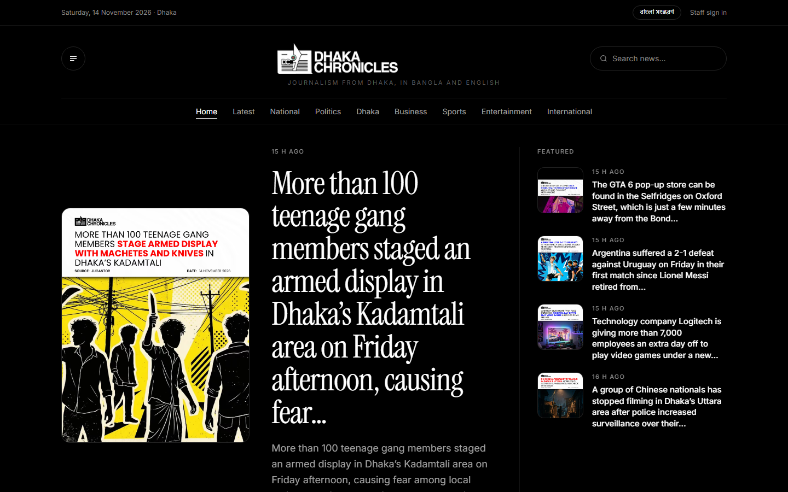

# Dhaka Chronicles

**Dhaka Chronicles** is a bilingual (English and Bangla) news website, plus the newsroom system behind it.

- **Readers** get a fast, phone-friendly news site in two editions.
- **Journalists** get a full newsroom:
  - Writing and editing, with a review step and scheduled publishing
  - A photo and video library
  - One-click imports from the [@dhakachronicles](https://www.instagram.com/dhakachronicles/) Instagram account
  - Automatic translation drafts
- **The business side** gets:
  - Brand deal tracking, with a public portfolio of past work
  - Website banner ads with view and click reports for advertisers
  - An enquiry form for new advertisers
- **Every important event** is posted to Discord.

| | |
|---|---|
| Live site | `https://dhakachronicles.com` (set by `SITE_URL`) |
| Newsroom | `/admin` (staff only, sign in at `/login`) |
| Instagram | [instagram.com/dhakachronicles](https://www.instagram.com/dhakachronicles/) |
| Facebook | [facebook.com/profile.php?id=61563127311472](https://www.facebook.com/profile.php?id=61563127311472) |
| Email | dhakachronicles@gmail.com |
| Newsroom guide (with screenshots) | [`docs/guide/README.md`](docs/guide/README.md) |



---

## Contents

1. [What it does](#1-what-it-does)
2. [Technology](#2-technology)
3. [How it is built](#3-how-it-is-built)
4. [Project layout](#4-project-layout)
5. [Data model](#5-data-model)
6. [Security](#6-security)
7. [Roles and permissions](#7-roles-and-permissions)
8. [Article workflow](#8-article-workflow)
9. [Instagram import](#9-instagram-import)
10. [Automatic sections, tags, featuring and sponsored labels](#10-automatic-sections-tags-featuring-and-sponsored-labels)
11. [Brand deals, ads and the Advertise page](#11-brand-deals-ads-and-the-advertise-page)
12. [Translation](#12-translation)
13. [Media and image optimisation](#13-media-and-image-optimisation)
14. [Analytics](#14-analytics)
15. [Discord notifications](#15-discord-notifications)
16. [SEO](#16-seo)
17. [Performance](#17-performance)
18. [Setup](#18-setup)
19. [Environment variables](#19-environment-variables)
20. [Database migrations](#20-database-migrations)
21. [Scheduled jobs](#21-scheduled-jobs)
22. [Testing](#22-testing)
23. [Deployment](#23-deployment)
24. [Troubleshooting](#24-troubleshooting)
25. [Routes reference](#25-routes-reference)
26. [Other documents](#26-other-documents)

---

## 1. What it does

### Public site

- **Two editions.** English lives at `/en` and Bangla at `/bn`; English is the default. Each story is a separate row per language, linked so readers can switch between versions.
- **Homepage:**
  - Lead story and Featured column
  - Latest grid and section blocks
  - Most read (last 3 days)
  - Instagram band
  - Partner (sponsored) content, clearly labelled
  - "Brands we've worked with"
  - Ad banners
  - The other language edition
- **Article page:**
  - Breadcrumb, byline, publish date and reading time
  - Share buttons (WhatsApp, Facebook, X, LinkedIn, copy link, native share)
  - Photo gallery and embedded video
  - Tags, a link to the original Instagram post, and related stories
  - "Report an error", a square ad, and a reading-progress bar
- **Sections, tags, authors, Latest, Search, Our team, Advertise, Privacy:** each has its own page.
- **Search:**
  - Instant previews as you type in the header.
  - An empty search shows the newest stories.
- **Advertise:**
  - Proof of past brand work
  - Five ad formats and banner sizes drawn to scale
  - How it works
  - An enquiry form
- **Advertiser reports:** a private page at `/en/ad-report/<token>` shows an ad's views and clicks.
- **Responsive:** works on phones, tablets and desktops. Phones get a swipeable section bar and a compact menu.

### Newsroom (`/admin`)

| Page | What it is for |
|---|---|
| **Overview** | Readers right now, views chart, top stories, pipeline, Instagram status, team activity, homepage highlight |
| **Articles** | List, filter, bulk actions (publish, archive, feature…), editor, preview, revisions, translation |
| **Instagram** | Browse the feed, pick posts, import as drafts or publish in one step, approve drafts, retry failures (main admins only) |
| **Media** | Upload, browse, caption and delete images and video |
| **Sections / Tags** | Manage categories and tags (most are added automatically) |
| **Authors** | Bylines shown on stories |
| **Brand deals** | Sponsorship pipeline (lead → published), fees, invoices; opt brands into the public portfolio |
| **Ads** | Website banners in three sizes, placement, dates, views/clicks, advertiser report link |
| **Team page** | People shown on the public "Our team" page |
| **Staff** | Sign-in accounts, roles, invites, password resets |
| **Profile** | Your photo, name, password, your activity |
| **Settings** | Site name, SEO defaults, social links, Discord channels, Instagram import mode |

---

## 2. Technology

| Layer | Choice | Why |
|---|---|---|
| Framework | **Next.js 16** (App Router, React 19, TypeScript strict) | One project for site, newsroom and API; server components keep secrets on the server |
| Styling | **Tailwind CSS v4** with design tokens | Brand colours/typography in one place (`src/app/globals.css`) |
| Database, auth | **Supabase** (Postgres + Row Level Security + Auth) | Rules live in the database; email invites; managed backups |
| Media storage | **Cloudflare R2** behind `media.dhakachronicles.com` | Cheap storage with no egress fees; images are served straight from the CDN |
| Images | **Sharp** | Converts uploads to AVIF + WebP in several widths |
| Editor | **Tiptap 3** | Rich text with images, video, quotes and lists; stored as JSON, rendered safely |
| Instagram | **Instagram API with Facebook Login** (Graph API v27) | Official API; tokens are encrypted at rest |
| Email | **Resend** (as Supabase Auth's SMTP) | Branded invite and password emails |
| Alerts | **Discord webhooks** | Three channels: articles, activity, alerts |
| Validation | **Zod 4** | Every form, API body and environment variable is checked |
| Tests | **Vitest** + **PGlite** | Database and RLS tests run in-process (no Docker) |
| Fonts | Inter, Instrument Serif, Hind Siliguri via `next/font` | Self-hosted at build time |

---

## 3. How it is built

```
Reader's browser ──► Next.js (Vercel)
                       ├─ Public pages (server-rendered, cached with ISR)
                       ├─ /admin newsroom (server components + server actions)
                       └─ /api/* route handlers (views, search, ads, reports, cron, media, instagram)
                              │
                ┌─────────────┼───────────────┬────────────────┐
                ▼             ▼               ▼                ▼
          Supabase       Cloudflare R2    Instagram       Discord webhooks
       (Postgres, RLS,   (images/video,   Graph API       (article / activity /
        Auth, Cron)       public CDN)                       alerts)
```

**Design principles:**

1. **One app.** The site, newsroom and API are one Next.js project, with no separate servers.
2. **Secrets never reach the browser.** The Supabase URL and keys and the R2, Instagram, Discord and AI keys are all server-only. They are read through `src/lib/env.ts` and validated at start-up. The browser only holds an httpOnly session cookie.
3. **Two layers of permission checks.** Server code checks the permission matrix (`src/lib/auth/permissions.ts`), and Postgres RLS enforces the same rules again. Either one alone would block a bad request.
4. **The public reads only safe data.** Anything sensitive, such as fees, contacts or ad tokens, is exposed only through `security definer` SQL functions that return safe columns (`public_partners()`, `live_ads()`, `ad_report(token)`, `most_read()`).
5. **One row per language.** Translations share a `translation_group_id`, and each language is published on its own.
6. **Pages are cached and refreshed on change.** Public pages use ISR (`revalidate`), and publishing, editing or settings changes refresh the affected pages straight away.
7. **Every action gives feedback.** Every server action ends with a success or error message, and every important action is audited and mirrored to Discord.

---

## 4. Project layout

```
src/
  app/
    [lang]/                    Public site, lang = en | bn
      page.tsx                 Homepage
      news/[slug]/             Article
      category/[slug]/  tag/[slug]/  author/[slug]/
      latest/  search/  team/  advertise/  privacy/
      ad-report/[token]/       Private advertiser report (noindex)
      rss.xml/                 RSS feed per language
      [...rest]/ + not-found   Branded 404
    (cms)/
      login/  set-password/  welcome/     Staff sign-in and onboarding
      admin/                              Newsroom (see table above)
        actions.ts                        Server actions for admin pages
        newsroom-actions.ts               Staff/profile/settings actions
    api/
      ads/click  ads/event                Ad click redirect + impression counter
      advertise                           Advertiser enquiry → brand-deal lead
      report                              "Report an error" → Discord
      search  views  presence  me         Search previews, view counter, live readers, staff check
      media/presign  media/finalize       Direct-to-R2 uploads
      instagram/connect|callback|webhook  Instagram login and webhook
      cron/publish  cron/instagram-sync   Scheduled jobs (Bearer CRON_SECRET)
    auth/confirm                          Email-link sign-in (invites, resets)
    sitemap.ts  robots.ts  news-sitemap.xml/
  components/
    public/      Header, footer, cards, ads, partner grid, forms, share bar, search
    admin/       Editor, image field, pickers, toasts, buttons, nav
    content/     Safe Tiptap JSON → HTML renderer
    ui/          Restyled shared components (badge, table, skeleton, toast, …)
    brand/       Logo
  lib/
    env.ts                 Server-only, validated environment
    supabase/              server (user/RLS), public (anon) and admin (service role) clients
    auth/                  session, permissions, owners (main admins)
    articles/              validation (Zod), workflow (state machine), service (writes), queries (public reads)
    content/               Tiptap helpers, slugs, classify (auto sections/tags/sponsored)
    instagram/             Graph client, OAuth, sync/import, engagement, token crypto, drafts
    media/                 R2, Sharp pipeline, validation
    seo/                   metadata, JSON-LD, feeds, defaults, AI suggestions
    translate.ts           Machine translation (EN ↔ BN)
    discord.ts, discord-embed.ts, audit.ts, analytics.ts, rate-limit.ts, logger.ts
supabase/
  migrations/              Schema history, applied in order
  templates/invite.html    Branded invite email
  config.toml  seed.sql  cron.sql
tests/                     Vitest unit + database tests
design/                    Claude Design files and brand sources
docs/                      Setup guides, deployment, newsroom guide
```

---

## 5. Data model

Every table has RLS turned on.

| Table | Holds | Who can read | Who can write |
|---|---|---|---|
| `profiles` | Staff: name, role (admin/editor/writer), avatar | Staff | Self (limited), admins |
| `articles` | One row per language: title, slug, content (Tiptap JSON), status, dates, SEO fields, `translation_group_id`, source (manual/instagram) | Public: published only; staff: all | Writers (own drafts), editors, admins |
| `article_revisions` | Snapshots before big edits | Staff | System |
| `categories`, `tags`, `article_tags` | Sections and tags (EN + BN names) | Everyone | Editors, admins |
| `authors` | Public bylines (EN + BN), avatar, optional link to a staff profile | Everyone | Editors, admins |
| `media` | R2 key, public URL, size, AVIF/WebP variants, alt text, caption, credit | Everyone | Uploaders, editors |
| `instagram_*` | Connection (encrypted token), imports (status, retries, likes, comments, auto-featured), sync runs | Staff | System, main admins |
| `article_views`, `presence` | Daily views, live readers | Via functions only | Via functions only |
| `brand_deals` | Brand, contact, stage, deliverables, fee, dates, checklist, notes, and the public portfolio fields (`show_on_site`, logo, blurb, proof link, website) | Editors, admins (public only via `public_partners()`) | Editors; delete: admins |
| `ads` | Name, advertiser, link, placement, dates, active, secret `report_token` | Editors, admins (public via `live_ads()` / `ad_report()`) | Editors; delete: admins |
| `ad_creatives` | One image per size: `wide`, `mobile`, `square` | Editors | Editors |
| `ad_stats` | Daily impressions and clicks per ad | Editors (public via report token) | Only `record_ad_event()` |
| `team_members` | Public Team page: photo, names, roles, bios, Instagram, order, visible | Public: visible only | Admins |
| `site_settings` | Site name, SEO defaults, social links, Discord, highlight, import mode | Everyone (safe keys) | Admins |
| `audit_log`, `notifications` | Every staff action; in-app notifications | Admins / own | System |

**Key SQL functions** (all `security definer` with a fixed `search_path`):

| Function | Purpose |
|---|---|
| `most_read(lang, days, n)` | Ids of the most-read stories (no counts) |
| `record_article_view(id)` | Counts a view, for published stories only |
| `public_partners()` | Portfolio brands, safe columns only |
| `live_ads(placement)` | Ads running today (Dhaka date) with their images |
| `record_ad_event(id, kind)` | Counts an impression or click, for live ads only |
| `ad_report(token)` | One ad's report, only with its 64-character secret token |
| `submit_ad_enquiry(…)` | Turns the Advertise form into a brand-deal lead |
| `rate_limit_hit(key, limit, window)` | Shared fixed-window rate limiter |

---

## 6. Security

- **Server-only secrets.** No `NEXT_PUBLIC_` variable carries Supabase or any other key.
- **Service-role client.** It is used only in server code for cron, provisioning and integrations (`src/lib/supabase/admin.ts`) and is never imported by client code.
- **Row Level Security** is on every table and covered by tests in `tests/db.test.ts`.
- **Main admins:** `admin@zaber.tech` and `admin@dhakachronicles.com`, overridable with `OWNER_EMAILS`.
  - Only they can manage Instagram and reset other people's passwords.
  - Nobody, including each other, can change or remove a main admin.
- **Sign-ups are disabled.** Staff join by invite only.
- **Rate limits:**
  - Sign-in
  - Views
  - Search
  - Ad impressions and clicks
  - Advertiser enquiries (3 per 10 minutes)
  - Error reports (5 per 10 minutes)
- **Spam protection:** the enquiry and error-report forms have a hidden honeypot field that catches bots.
- **Instagram tokens** are encrypted at rest with AES-256-GCM (`TOKEN_ENCRYPTION_KEY`), and only the `dhakachronicles` account can be connected.
- **Media downloads** come only from Instagram's CDNs over HTTPS, which blocks server-side request forgery. Uploads are checked by file signature, not just by extension.
- **Cron endpoints** require `Authorization: Bearer <CRON_SECRET>`, compared in constant time.
- **Safe rendering:** article content is Tiptap JSON rendered by our own component, so no raw HTML is ever injected.
- **Security headers:** `X-Content-Type-Options`, `Referrer-Policy`, `X-Frame-Options`, `Permissions-Policy`.
- **Labelled paid content:** sponsored stories and ads are always labelled, and ad links use `rel="sponsored nofollow"`.

---

## 7. Roles and permissions

| Permission | Writer | Editor | Admin | Main admin |
|---|:-:|:-:|:-:|:-:|
| Write articles | ✓ (own drafts) | ✓ | ✓ | ✓ |
| Edit anyone's articles, publish, schedule | | ✓ | ✓ | ✓ |
| Delete articles | | | ✓ | ✓ |
| Upload media | ✓ | ✓ | ✓ | ✓ |
| Sections, tags, authors | | ✓ | ✓ | ✓ |
| Brand deals and ads | | ✓ | ✓ (and delete) | ✓ |
| View Instagram | | ✓ | ✓ | ✓ |
| **Manage Instagram** (connect, import, settings) | | | | ✓ |
| Team page, staff, settings, audit log | | | ✓ | ✓ |
| Reset passwords, edit/remove staff | | | | ✓ |

---

## 8. Article workflow

```
           submit              approve / publish
 draft ───────────► pending_review ─────────────► published
   ▲   ◄─────────────┘ return_to_draft                │
   │                                                  │ unpublish
   │          schedule (date/time)                    ▼
   └──────────────────────────────► scheduled ──► published (by cron, every minute)
 archive ◄── any state ── restore ──► draft
```

- **Writers** can only submit for review. **Editors and admins** can publish or schedule.
- The state machine lives in `src/lib/articles/workflow.ts` (unit-tested) and is checked again in SQL.
- **Revisions** are saved before significant edits and can be restored.
- **Publishing** refreshes the homepage, the article, the section, the sitemaps and RSS, and posts to the Discord article log.
- **Instagram stories** use the original post time as their publish date.

---

## 9. Instagram import

1. A main admin connects @dhakachronicles once (**Instagram → Connect**). The token is encrypted and stored, and refreshed before it expires.
2. **Browse:** the Instagram page shows the feed with thumbnails, dates and whether each post was already imported.
3. **Pick posts:** tick posts and choose **Import as drafts** or **Import and publish**, optionally with a section.
4. **For each post, in parallel (several posts at once, each downloading up to 4 images at a time):**
   - Photos and carousel images are downloaded and optimised. Reels and videos are stored with their cover image.
   - A draft is created:
     - Headline: the caption's first sentence, cleaned up.
     - Body: the full caption, kept word for word.
     - The original post is linked as the source.
     - The language is detected (Bangla or English).
   - A section and tags are added automatically (see §10).
   - Collaborations and paid posts are tagged **Sponsored**.
5. **Approve:** drafts wait under **Instagram → Drafts** for one-click approval. Imports never publish themselves unless you chose "Import and publish".
6. **Failures:** failed imports retry automatically with growing gaps (5 min, 20 min, 80 min…, up to the maximum attempts) and appear under **Failed**, with a retry button that works without reloading the page.
7. **Auto-sync:** every 15 minutes, the sync refreshes likes and comments, re-ranks featured stories, and (if auto-import is on) brings in new posts.

---

## 10. Automatic sections, tags, featuring and sponsored labels

- **Sections:**
  - `src/lib/content/classify.ts` scores each story against keyword lists for each section in English and Bangla, and picks the best match.
  - Stories that don't match are still placed, so no story is left without a section.
  - **Instagram → Sort all stories now** re-sorts the whole back catalogue (it also runs every 15 minutes for unsorted stories).
- **Tags:**
  - People, places and organisations found in the text, plus the post's hashtags.
  - camelCase hashtags are split into words, e.g. `#DhakaTraffic` becomes "Dhaka Traffic".
- **Sponsored:** captions with partnership signals ("paid partnership", "collab", "sponsored", "in association with", Bangla equivalents…) get the **Sponsored** tag. Linking a brand deal to an article does the same.
- **Featured:**
  - Editors can feature or unfeature stories by hand, or pin one story as the **homepage highlight**.
  - The site also features the week's top Instagram posts by engagement (likes + 3 × comments). It only ever removes stories it featured itself, so editors' choices are never overridden.
  - **Instagram → Most-liked posts on the homepage** (main admins) turns this on or off, sets how many (2–8), and can make the #1 post the homepage lead. The ranking chooses the lead only when no editor has pinned one: `homepage_highlight.auto` marks an automatic pin, and the setting is stored in `site_settings.auto_feature`.

---

## 11. Brand deals, ads and the Advertise page

**Brand deals (portfolio and credibility):**
- The commercial pipeline: lead → negotiating → contracted → in production → published, or cancelled.
- Each deal has fee and currency, a due date, an owner, a linked article, and a checklist (brief approved, brand sign-off, invoice sent, paid). It can't be marked paid before it is invoiced.
- **Show on the website (portfolio):** the brand's logo, a one-line description of the work and a proof link appear on the homepage and the Advertise page. Fees, contacts and notes are never exposed.

**Ads (website banners):**
- An ad has a name, advertiser, link (https only), placement (homepage, inside articles or both), start and end dates, and a pause switch.
- **Three image sizes.** The site picks per screen using `<picture>` media queries:

  | Size | Pixels | Used |
  |---|---|---|
  | Desktop banner (`wide`) | 1200 × 300 (4:1) | Homepage on tablets and desktops |
  | Phone banner (`mobile`) | 640 × 320 (2:1) | Homepage on phones |
  | Square (`square`) | 600 × 600 | Inside articles |

- **Impressions:** one is counted when at least half the ad has been on screen for 1 second (`IntersectionObserver` + `sendBeacon`).
- **Clicks** go through `/api/ads/click?id=…`, which counts the click and redirects. Only ads running today redirect.
- **Report link:** each ad has a private `/en/ad-report/<64-hex token>` page with total views, clicks, click rate and a daily chart. Search engines are told not to index it.
- **Labels:** ads are always marked "Advertisement" / "বিজ্ঞাপন", with `rel="sponsored nofollow noopener"`.

**Advertise page:** proof of past work, five formats, banner sizes drawn to scale, a four-step process, and an enquiry form. Each enquiry:
1. creates a **lead** in Brand deals (with phone, budget and message in the notes), and
2. posts to the Discord activity channel with a link to the lead.

---

## 12. Translation

- **On any article:**
  - **Translate to Bangla automatically** (or English) creates the other-language version as a **draft**. Headline, subtitle, summary and body are translated; formatting, images, video, links, section and tags are kept.
  - **Write by hand** creates an empty linked draft instead.
- **How:** text runs are pulled from the Tiptap document (`docTexts`), translated in batches through any OpenAI-compatible chat API (`AI_SEO_API_URL`, `AI_SEO_API_KEY`, `AI_SEO_MODEL`), and put back in place (`replaceDocTexts`).
- **Prompt rules:** no added or removed facts; names, numbers, handles, hashtags and URLs are kept.
- **Review:** an editor must review the draft before publishing. Machine translation is a starting point, not a final copy.

---

## 13. Media and image optimisation

- **Uploads** go straight from the browser to R2 using a presigned URL. The server then verifies the file type from its bytes and creates AVIF and WebP variants in several widths (Sharp).
- **On the site:**
  - Images use `<picture>` with `srcset`/`sizes`, so phones download small files.
  - The lead image loads first with high priority; everything else loads lazily.
- **Caching:** objects are stored with `Cache-Control: public, max-age=31536000, immutable`, and the page opens a connection to the image CDN early (`preconnect`).
- **Video** (reels) is stored as MP4 with a poster image and plays inline.
- **Deleting media** that a published article still uses is blocked by a database trigger.

---

## 14. Analytics

- **Views:** counted by `/api/views` for published stories only. Stored as daily counts; no personal data is kept.
- **Live readers:** `/api/presence` heartbeats feed "Reading now".
- **Overview dashboard:**
  - Views chart (smooth curve with hover tooltip, peak and change against the previous period)
  - Top articles with trend
  - Views by section, and the Bangla/English share
  - Pipeline counts, Instagram status and team activity
- **Ads:** impressions, clicks and click rate per ad and in total.

---

## 15. Discord notifications

Set up to three webhooks (env or **Settings → Discord**):

| Channel | Gets |
|---|---|
| **Article log** (`DISCORD_ARTICLE_WEBHOOK_URL`) | Published, scheduled, sent for review, Instagram imports, with links to the site, the editor and Instagram, the image and the section |
| **Activity log** (`DISCORD_ACTIVITY_WEBHOOK_URL`) | Every audited staff action (sign-ins, edits, invites, settings, deals, ads, team page) and advertiser enquiries. Rapid repeat edits are grouped to keep the channel quiet. |
| **Alerts** (`DISCORD_ALERTS_WEBHOOK_URL`) | Failures, rate limits, expired tokens, sign-in abuse, **reader error reports**. Falls back to the activity channel. |

All messages use the same embed style (`src/lib/discord-embed.ts`, unit-tested).

---

## 16. SEO

- **Metadata:**
  - Per-page title, description, canonical, Open Graph and Twitter cards.
  - **hreflang** links between the English and Bangla versions.
- **Structured data (JSON-LD):** `NewsMediaOrganization` (with social profiles and contact email), `NewsArticle` and `BreadcrumbList`.
- **Sitemaps:** `sitemap.xml`, `news-sitemap.xml` (Google News) and RSS per language (`/en/rss.xml`, `/bn/rss.xml`).
- **robots.txt:** blocks `/admin`, `/api` and `/login`. Ad reports are `noindex`.
- **In the editor:** SEO fields with sensible defaults, and optional AI suggestions (title, description, keyword).

---

## 17. Performance

- **Server-rendered pages with ISR:** the homepage refreshes every 60 s and on publish.
- **Parallel loading:** the homepage loads its data in two parallel waves.
- **Fonts** are self-hosted with `next/font`, so there are no runtime requests to Google.
- **Images** are pre-optimised AVIF/WebP, sized per screen, lazy-loaded, and served from the CDN with a one-year cache.
- **Small client bundles:** interactive pieces (search, menu, share, forms, trackers) are small client components; everything else is server-rendered.

---

## 18. Setup

**Requirements:** Node 20+ and npm, plus a Supabase project, a Cloudflare R2 bucket, and (optionally) a Meta app, a Resend account, Discord webhooks and an AI API key.

```bash
npm install
cp .env.example .env.local        # fill in values; never commit this file
npx supabase link --project-ref <ref>
npx supabase db push --remote     # apply all migrations
npm run provision-admin -- admin@dhakachronicles.com "Admin Name"
npm run dev                       # http://localhost:3000, staff sign in at /login
```

Detailed guides:
- **Supabase** (project, auth, SMTP with Resend, invite template, disabling sign-ups): [`SUPABASE_SETUP.md`](SUPABASE_SETUP.md)
- **R2** (bucket, keys, public domain, CORS): [`docs/R2_SETUP.md`](docs/R2_SETUP.md)
- **Instagram** (Meta app, Unified Login config, redirect URI, webhook): [`docs/INSTAGRAM_SETUP.md`](docs/INSTAGRAM_SETUP.md)
- **Deployment** (Vercel, env, cron, domains): [`docs/DEPLOYMENT.md`](docs/DEPLOYMENT.md)

---

## 19. Environment variables

All are **server-only** (never `NEXT_PUBLIC_`). See [`.env.example`](.env.example).

| Variable | Required | Purpose |
|---|:-:|---|
| `SUPABASE_URL`, `SUPABASE_PUBLISHABLE_KEY`, `SUPABASE_SECRET_KEY` | ✓ | Database and auth |
| `SITE_URL` | ✓ | Public origin (canonical URLs, sitemaps, email links, OAuth) |
| `DEFAULT_LANGUAGE` | | `en` (default) or `bn` for `/` |
| `CRON_SECRET` | ✓ prod | Protects `/api/cron/*` (16+ characters) |
| `R2_ACCOUNT_ID`, `R2_ACCESS_KEY_ID`, `R2_SECRET_ACCESS_KEY`, `R2_BUCKET`, `R2_PUBLIC_BASE_URL` | ✓ media | Uploads and image hosting |
| `INSTAGRAM_APP_ID`, `INSTAGRAM_APP_SECRET`, `INSTAGRAM_CONFIG_ID`, `INSTAGRAM_REDIRECT_URI`, `INSTAGRAM_EXPECTED_USERNAME`, `INSTAGRAM_WEBHOOK_VERIFY_TOKEN` | Instagram | Import from @dhakachronicles |
| `TOKEN_ENCRYPTION_KEY` | Instagram | 32 random bytes (base64) to encrypt tokens |
| `DISCORD_ARTICLE_WEBHOOK_URL`, `DISCORD_ACTIVITY_WEBHOOK_URL`, `DISCORD_ALERTS_WEBHOOK_URL` | | Notifications |
| `AI_SEO_API_URL`, `AI_SEO_API_KEY`, `AI_SEO_MODEL` | | AI SEO suggestions **and automatic translation** |
| `OWNER_EMAILS` | | Comma-separated main admins (defaults to the two above) |
| `RESEND_API_KEY`, `SMTP_SENDER_EMAIL` | email | Go in `supabase/.env` for `supabase config push` |

---

## 20. Database migrations

Each schema change is a new file in `supabase/migrations/`, applied in order:

| Migration | Adds |
|---|---|
| `20261113000001_core_schema` | Profiles, articles, revisions, categories, tags, authors, media, Instagram, settings, audit |
| `20261113000002_rls_policies` | All RLS policies |
| `20261113000003_workflow_functions` | Publishing, scheduling, view counting, rate limiting |
| `20261114000001_analytics_presence_highlight` | Daily views, live readers, homepage highlight |
| `20261114000002_audit_read_own` | Staff can read their own audit trail |
| `20261114000003_public_most_read` | `most_read()` |
| `20261114000004_brand_deals` | Brand deal pipeline |
| `20261114000005_instagram_post_dates` | Original Instagram post time (with backfill) |
| `20261114000006_instagram_engagement` | Likes, comments, auto-featured flag |
| `20261114000007_partners_ads_people` | Public portfolio fields, `public_partners()`, `team_members` |
| `20261114000008_ads_and_enquiries` | `ads`, `ad_creatives`, `ad_stats`, `live_ads()`, `record_ad_event()`, `ad_report()`, `submit_ad_enquiry()` |

```bash
npx supabase migration new <name>          # create
npx supabase migration list --remote       # see what is applied
npx supabase db push --remote              # apply to production
```

Every migration comes with tests in `tests/db.test.ts`.

---

## 21. Scheduled jobs

`supabase/cron.sql` (run once after deploy) sets up Supabase Cron with `pg_net`. It stores the site URL and `CRON_SECRET` in Supabase Vault.

| Job | When | Calls |
|---|---|---|
| Publish scheduled articles | Every minute | `POST /api/cron/publish` |
| Instagram sync (engagement, auto-feature, optional auto-import, retries) | Every 15 minutes | `POST /api/cron/instagram-sync` |
| Cleanup (expired OAuth states, old rate-limit rows) | Daily 03:15 | SQL |

---

## 22. Testing

```bash
npm run typecheck   # TypeScript
npm run lint        # ESLint (0 errors expected)
npm test            # Vitest: 106 tests
npm run build       # Production build
```

- `tests/db.test.ts`: every migration runs in **PGlite** (Postgres in-process). It tests constraints, RLS for each role, and the public functions (no fees or tokens leak; expired ads aren't served; reports need the token).
- Unit tests cover the article workflow, permissions, slugs, classification, Instagram parsing and engagement ranking, encryption, concurrency limits, Discord embeds, SEO and translation helpers.

Run all four commands before every release.

---

## 23. Deployment

1. Create a Vercel project from this repository and add every environment variable (§19). Set `SITE_URL` to the production domain.
2. In Supabase:
   - **Auth → URL configuration:** set the Site URL and redirect URLs (`https://<domain>/auth/confirm`).
   - **SMTP:** set up Resend.
   - Keep sign-ups **disabled**.
3. Run `npx supabase db push --remote`, then run `supabase/cron.sql` (with the real URL and secret) in the SQL editor.
4. R2:
   - Point `media.<domain>` at the bucket.
   - Allow `PUT` from the site origin in CORS.
5. Instagram:
   - Register `https://<domain>/api/instagram/callback` as the redirect URI and the webhook URL.
   - A main admin connects the account in **Admin → Instagram**.
6. Check that `/en`, `/bn`, `/sitemap.xml`, `/news-sitemap.xml` and `/robots.txt` all load, and that invites arrive by email.

Full checklist: [`docs/DEPLOYMENT.md`](docs/DEPLOYMENT.md).

---

## 24. Troubleshooting

| Symptom | Cause / fix |
|---|---|
| "Could not find the function … in the schema cache" | A migration isn't on the database: `npx supabase db push --remote` |
| Image upload fails "Upload to storage failed (403)" | R2 CORS doesn't allow the site origin, or keys are wrong |
| `next/image` "hostname is not configured" | `R2_PUBLIC_BASE_URL` missing at build time (`next.config.ts` reads it) |
| Invite email link goes to localhost | Supabase **Auth → URL configuration → Site URL** still set to localhost |
| Instagram "token expired" alert | A main admin clicks **Reconnect** on the Instagram page |
| Scheduled story didn't publish | `cron.sql` not run, wrong `app_url` / `cron_secret` in Vault, or `CRON_SECRET` differs |
| "Automatic translation is not set up" | Set `AI_SEO_API_URL`, `AI_SEO_API_KEY`, `AI_SEO_MODEL` |
| Ads not showing | Ad paused, outside its dates, no images uploaded, or placement doesn't match the page |
| No Discord messages | Webhook URL missing, or test it in **Settings → Discord** |

---

## 25. Routes reference

**Public:**
- `/` → redirects to `/en`
- `/{en|bn}`, `/{lang}/latest`, `/{lang}/search`
- `/{lang}/news/{slug}`, `/{lang}/category/{slug}`, `/{lang}/tag/{slug}`, `/{lang}/author/{slug}`
- `/{lang}/team`, `/{lang}/advertise`, `/{lang}/privacy`, `/{lang}/rss.xml`, `/{lang}/ad-report/{token}`
- `/sitemap.xml`, `/news-sitemap.xml`, `/robots.txt`

**Staff:**
- `/login`, `/set-password`, `/welcome`, `/auth/confirm`
- `/admin`, plus `/admin/{articles, instagram, media, categories, tags, authors, brand-deals, ads, people, team, profile, settings}`

**API:**

| Method | Path | Notes |
|---|---|---|
| POST | `/api/views` | Count a story view |
| POST | `/api/presence` | Live-reader heartbeat |
| GET | `/api/search?q=` | Header search previews |
| GET | `/api/me` | Is this browser signed in as staff? (header link) |
| POST | `/api/ads/event` | Ad impression |
| GET | `/api/ads/click?id=` | Count click, redirect to advertiser |
| POST | `/api/advertise` | Advertiser enquiry |
| POST | `/api/report` | Reader error report |
| POST | `/api/media/presign`, `/api/media/finalize` | Staff uploads |
| GET | `/api/instagram/connect`, `/api/instagram/callback` | Instagram login |
| GET/POST | `/api/instagram/webhook` | Instagram webhook |
| POST | `/api/cron/publish`, `/api/cron/instagram-sync` | Cron (Bearer `CRON_SECRET`) |

---

## 26. Other documents

| File | What |
|---|---|
| [`docs/guide/README.md`](docs/guide/README.md) | **Newsroom guide A–Z with screenshots** |
| [`docs/CLIENT_GUIDE.md`](docs/CLIENT_GUIDE.md) | One-page quick reference |
| [`HANDOFF.md`](HANDOFF.md) | Full project context for a new developer |
| [`DECISIONS.md`](DECISIONS.md) | Why things are built the way they are |
| [`MASTER_TODO.md`](MASTER_TODO.md) | Done and remaining work |
| [`CHANGELOG.md`](CHANGELOG.md) | Release notes |
| [`CONTRIBUTING.md`](CONTRIBUTING.md) | Code rules, commits, reviews |
| [`AGENTS.md`](AGENTS.md) | Rules for AI coding agents |
| [`design/`](design/) | Claude Design files and brand sources |
