# Dhaka Chronicles: the complete guide (A to Z)

This guide shows how every part of the Dhaka Chronicles website and newsroom works, with pictures. It is written for the people who run the site day to day: editors, writers, the commercial team and admins. Developers should read the [README](../../README.md) as well.

**Contacts:**
- Instagram: [@dhakachronicles](https://www.instagram.com/dhakachronicles/)
- Facebook: [Dhaka Chronicles](https://www.facebook.com/profile.php?id=61563127311472)
- Email: dhakachronicles@gmail.com

---

## Contents

**Part 1. The public website**
- [A. The homepage](#a-the-homepage)
- [B. Bangla and English editions](#b-bangla-and-english-editions)
- [C. A story page](#c-a-story-page)
- [D. Sections, Latest and authors](#d-sections-latest-and-authors)
- [E. Search](#e-search)
- [F. Our team](#f-our-team)
- [G. Advertise](#g-advertise)
- [H. On a phone](#h-on-a-phone)
- [I. Page not found](#i-page-not-found)

**Part 2. The newsroom (`/admin`)**
- [J. Signing in](#j-signing-in)
- [K. Overview](#k-overview)
- [L. Articles: writing, review, publishing](#l-articles-writing-review-publishing)
- [M. Translation (English ↔ Bangla)](#m-translation-english--bangla)
- [N. Instagram import](#n-instagram-import)
- [O. Media library](#o-media-library)
- [P. Sections, tags and authors](#p-sections-tags-and-authors)
- [Q. Featured stories and the homepage highlight](#q-featured-stories-and-the-homepage-highlight)
- [R. Brand deals (your portfolio)](#r-brand-deals-your-portfolio)
- [S. Ads (website banners)](#s-ads-website-banners)
- [T. Advertiser enquiries](#t-advertiser-enquiries)
- [U. Team page](#u-team-page)
- [V. Staff, roles and passwords](#v-staff-roles-and-passwords)
- [W. Your profile](#w-your-profile)
- [X. Settings](#x-settings)
- [Y. Discord notifications](#y-discord-notifications)
- [Z. Rules, tips and troubleshooting](#z-rules-tips-and-troubleshooting)

---

# Part 1. The public website

## A. The homepage

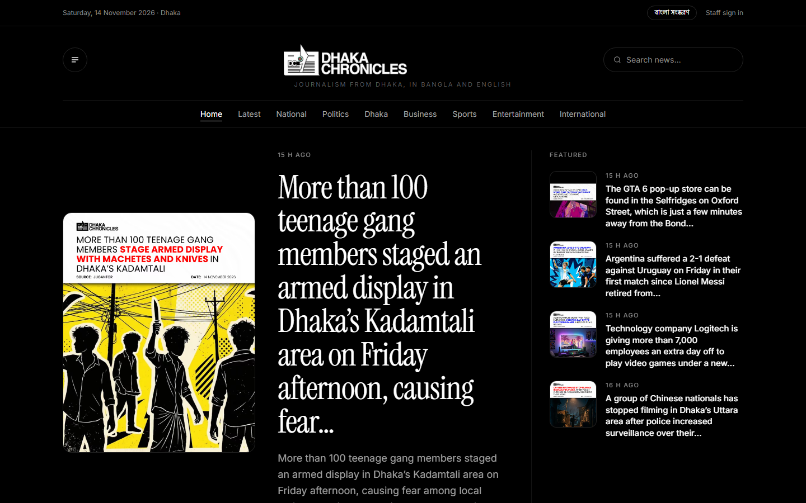

The top of every page has:
- **Date and edition switch:** today's date, the **বাংলা সংস্করণ / English edition** button, and **Staff sign in**. If you are already signed in, it says **Newsroom** instead.
- **Menu button** (left): opens a compact list of every section, plus Search, Our team and Advertise.
- **Logo:** goes back to the homepage.
- **Search box** (right): shows matching stories as you type.
- **Section bar:** Home, Latest and every section. On phones it scrolls sideways.

The homepage is built automatically from your stories, in this order:

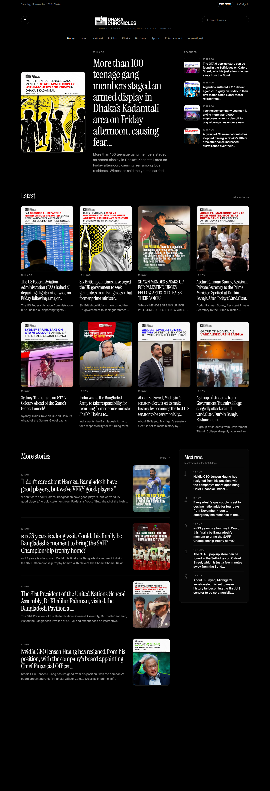

1. **Lead story.** The big story at the top. It is the story you pinned as the **highlight**, otherwise the newest featured story, otherwise the newest story.
2. **Featured column.** Up to four featured stories. You feature stories by hand, and the site also features the week's most-liked Instagram posts on its own (see [Q](#q-featured-stories-and-the-homepage-highlight)).
3. **Ad banner.** Appears only when an ad is running (see [S](#s-ads-website-banners)).
4. **Latest.** The eight newest stories not already shown above.
5. **Section block with Most read.** Stories from your busiest section, next to the five most-read stories of the last three days.
6. **Instagram band.** Recent posts from @dhakachronicles with a follow link.
7. **Partner content.** Stories tagged **Sponsored**, in a clearly marked box.
8. **Brands we've worked with.** Logos of brands you chose to show (see [R](#r-brand-deals-your-portfolio)).
9. **More sections.** Three more sections, side by side.
10. **The other edition.** The newest stories in the other language.

Nothing on the homepage needs manual layout work: publish a story and it appears in the right places within a minute.

## B. Bangla and English editions

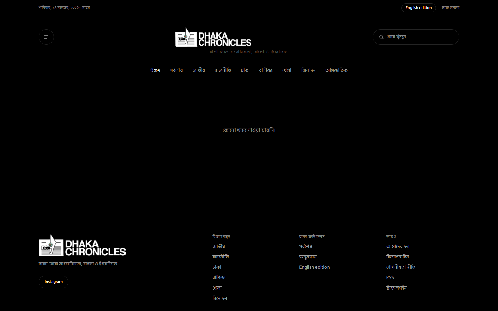

- **English** is at `/en` (the default) and **Bangla** is at `/bn`.
- Each edition has its own stories. The same story in two languages is linked, so readers can jump between versions.
- Menus, dates and labels change language too.
- Search engines are told about both versions, so each edition shows up in the right searches.

## C. A story page

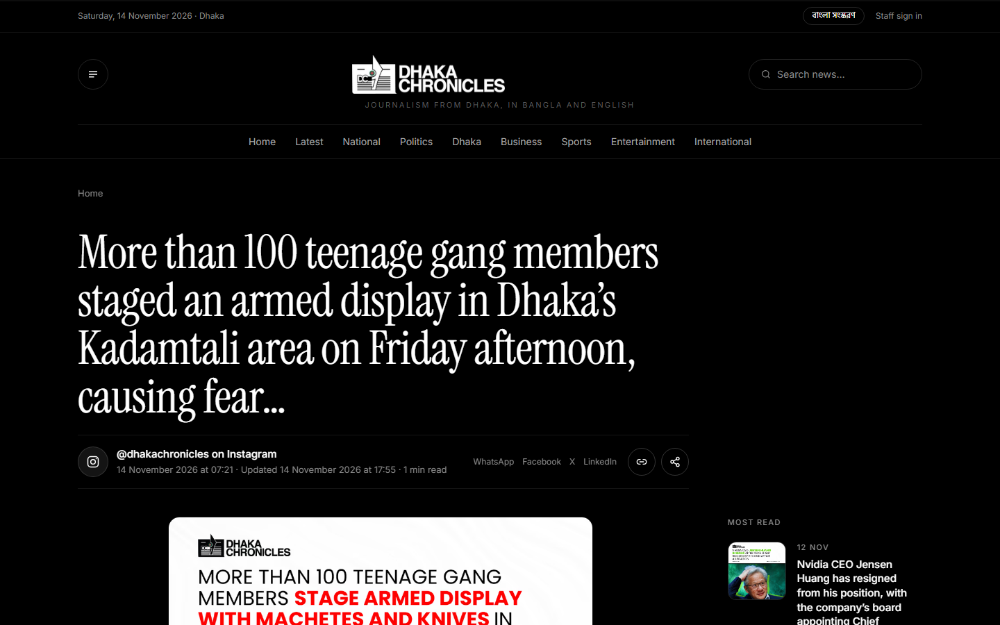

From top to bottom:
- **Breadcrumb:** Home › Section.
- **Headline**, then the **byline**:
  - For stories imported from Instagram, the byline is the Instagram logo and *@dhakachronicles on Instagram*.
  - For other stories, it is the author's name and photo.
- **Publish date and time.** Instagram stories show when the post was made. If the story was edited later, "Updated …" is added, followed by the reading time.
- **Share buttons** (right): WhatsApp, Facebook, X, LinkedIn, **copy link**, and the phone's own share menu.
- **Main photo**, then the **story**: text, photo galleries, embedded video, quotes and lists.
- **Labels:** stories tagged Sponsored show a **Sponsored** label at the top.
- **Tags**, and **Source: Instagram →** for imported posts.
- **Report an error:** readers can tell you about a mistake (see below).
- **Square ad**, only if an ad is running inside articles.
- **Most read** (right column on big screens) and **related stories** at the bottom.
- A thin **reading-progress bar** at the top of the screen.

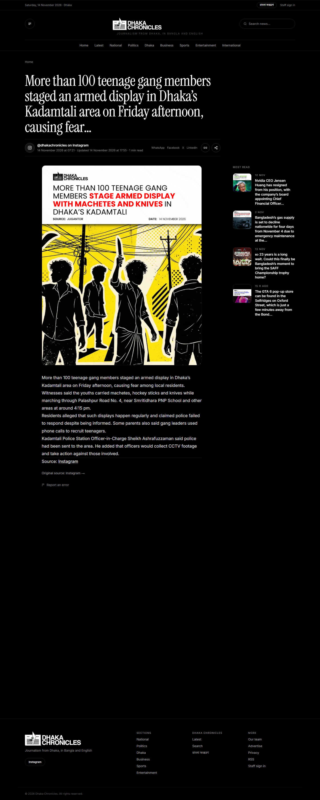

### Report an error

Under every story there is a **Report an error** link. The reader:
1. picks what is wrong: wrong fact, typo, translation, wrong photo, or something else;
2. writes what should change, and can leave an email for a reply;
3. presses **Send report**.

The report arrives in your Discord **alerts** channel with the story title, the reader's message and a link to edit the story. Each person can send up to five reports every ten minutes, and a hidden field stops spam bots.

## D. Sections, Latest and authors

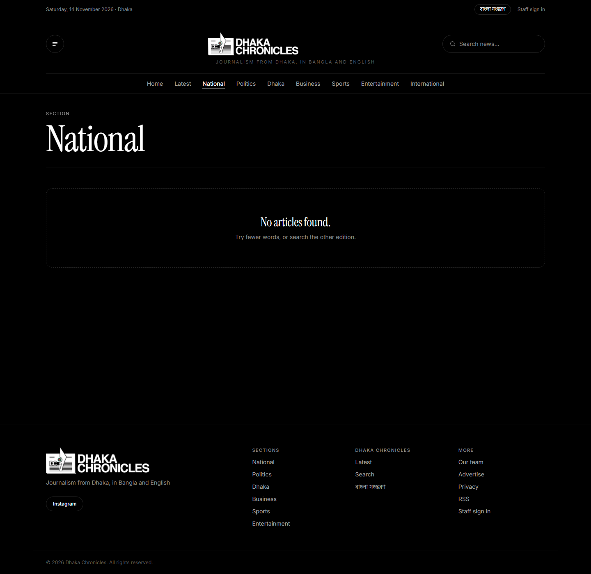

- **Section pages** (`/en/category/national`, …) list every story in that section, newest first, with page numbers.
- **Latest** (`/en/latest`) lists every story, newest first.
- **Tag pages** and **author pages** work the same way.

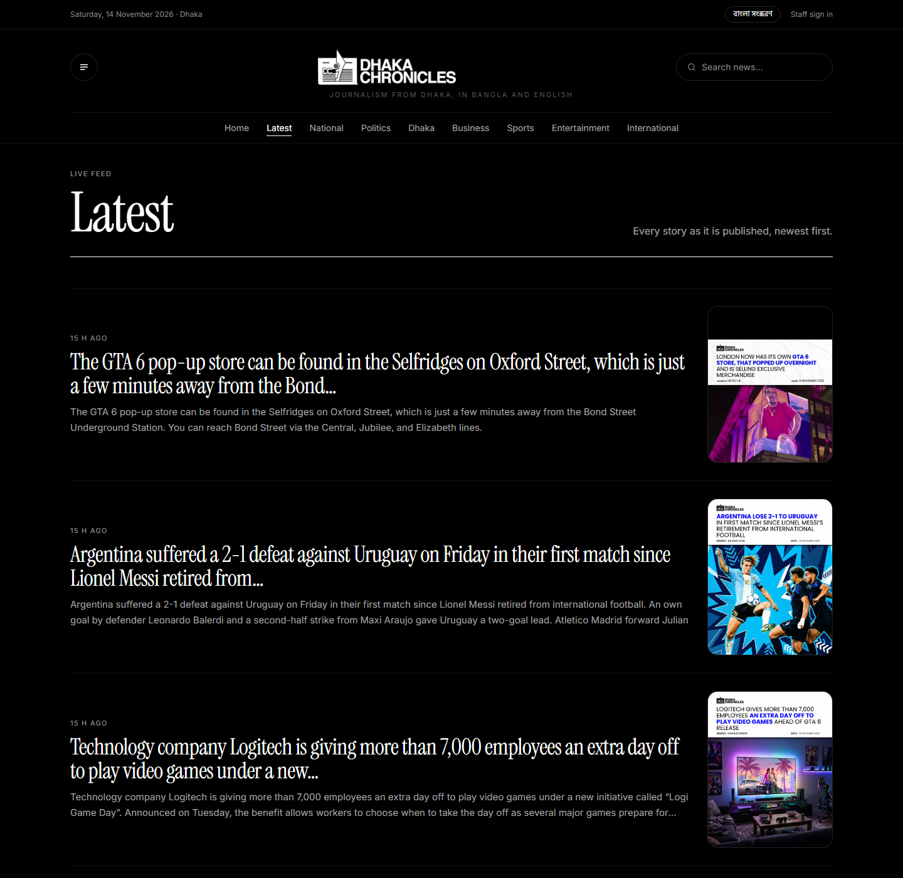

## E. Search

| Empty search | With a search term |
|---|---|
| 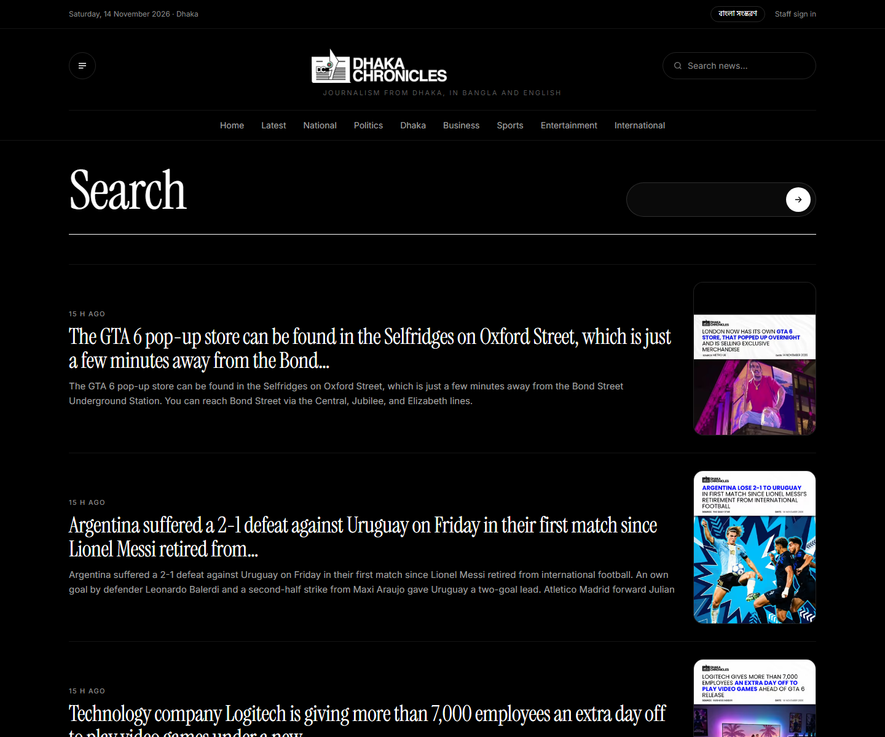 | 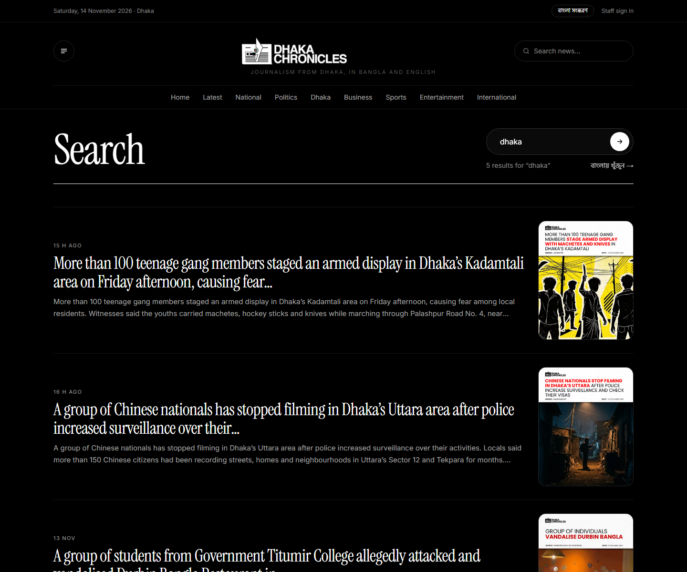 |

- Typing in the header shows **instant previews**. Press Enter for the full results page.
- With nothing typed, the search page shows the newest stories.

## F. Our team

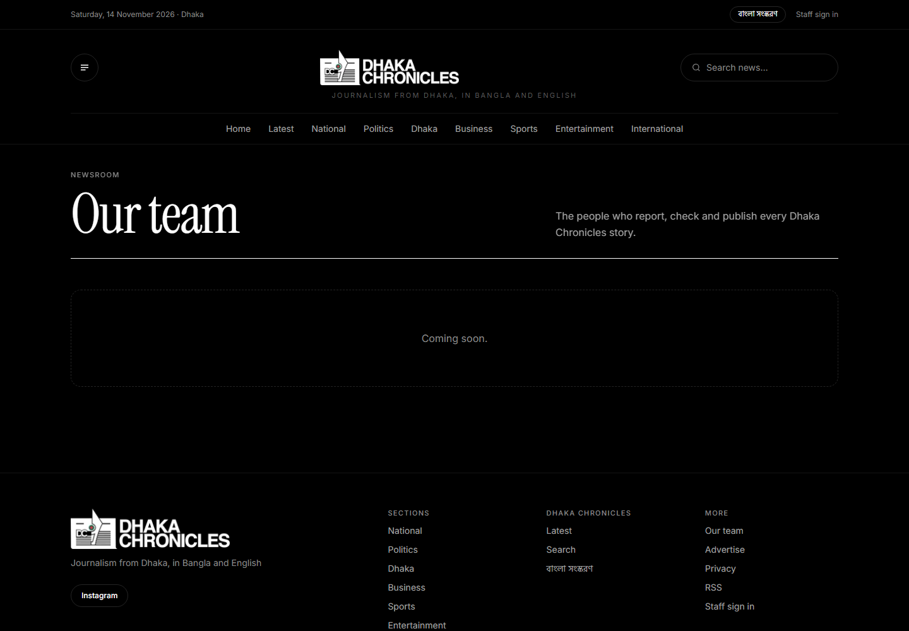

This page shows the people **you** add in **Admin → Team page** (see [U](#u-team-page)): photo, name, role, short bio, Instagram handle and a link to their stories. It is not filled in automatically. Until you add someone, it shows "Coming soon".

## G. Advertise

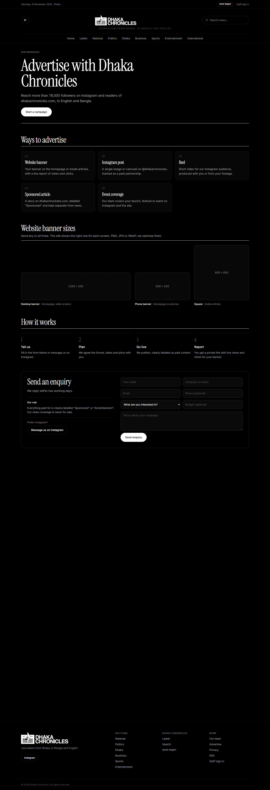

This page is written to win advertisers. It has:
1. **Headline and reach:** more than 78,000 Instagram followers, plus website readers.
2. **Brands we've worked with:** logo cards with what you did together and a **See the work ↗** link to the proof (see [R](#r-brand-deals-your-portfolio)).
3. **Ways to advertise:** website banner, Instagram post, reel, sponsored article, event coverage.
4. **Website banner sizes,** drawn to scale:
   - Desktop banner: 1200 × 300
   - Phone banner: 640 × 320
   - Square: 600 × 600
5. **How it works:** tell us, plan, go live, report.
6. **Enquiry form:** name, company, email, phone, format, budget, message. Sending it creates a **lead** in Brand deals and a Discord message (see [T](#t-advertiser-enquiries)).
7. **Our rule:** paid content is always labelled. Message buttons for Instagram and Facebook, plus the email address.

## H. On a phone

| Homepage | Menu | Story |
|---|---|---|
| 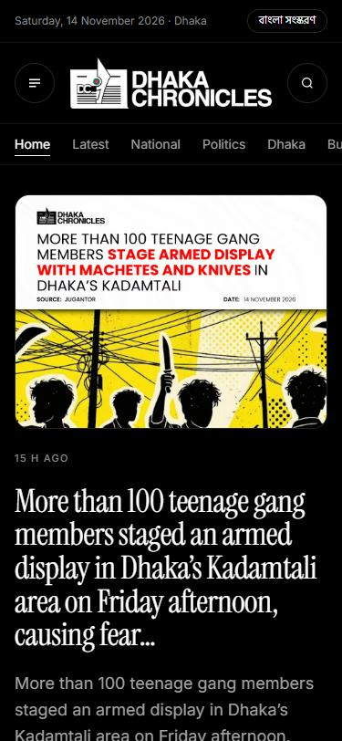 | 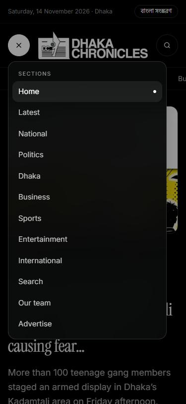 | 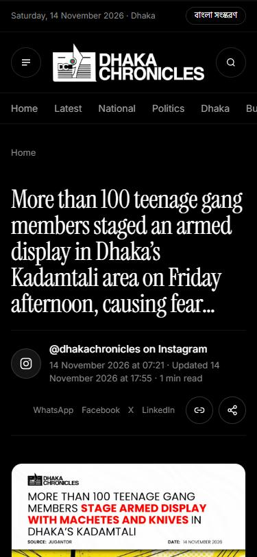 |

- The section bar scrolls sideways under the logo.
- The menu is a small drop-down panel, not a full-screen cover.
- Pictures are sized for the phone, so pages load quickly on mobile data.
- Ads use the **phone banner** image on phones if you uploaded one.

## I. Page not found

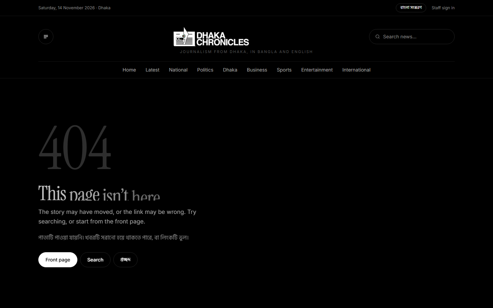

Any wrong address shows a branded page with links back to the homepage and to search.

---

# Part 2. The newsroom (`/admin`)

## J. Signing in

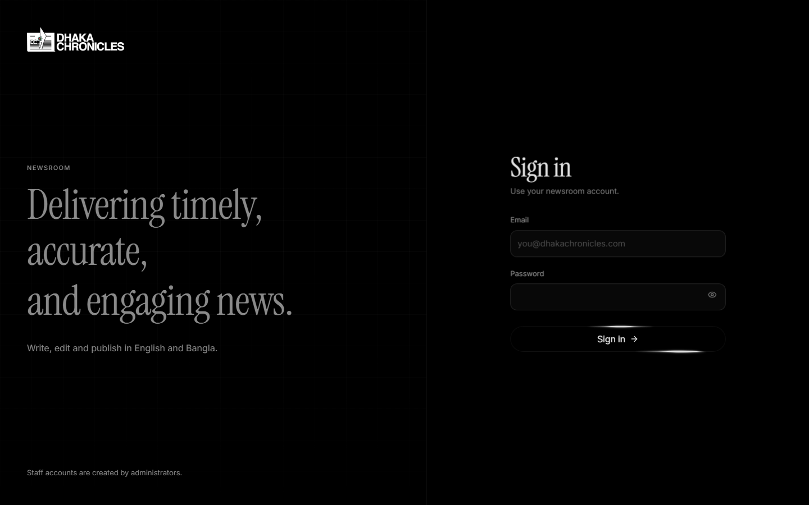

- Go to **`/login`**, or click **Staff sign in** at the top right of the site.
- Enter your **email** and **password**. The eye button shows the password while you type.
- Press **Sign in**. You land on the Overview page.

**New staff:**
- They receive a branded **invitation email**, click the link, and choose their own password.
- Or an admin creates the account with a starting password and passes it on privately (see [V](#v-staff-roles-and-passwords)).

**Forgot your password?** A main admin can reset it.

> Nobody can sign themselves up. Staff join only by invitation. Too many wrong passwords from one place are blocked for a while, and the alerts channel is told.

### The newsroom layout

Every newsroom page has the same frame:
- **Left sidebar** (computers): logo, **+ New article**, the menu, your name and role, **View site ↗** and **Sign out**.
- **Top bar** (phones): logo, **+** (new article), the bell (notifications) and your photo (profile). The menu becomes a row you can swipe.

**Menu items:** Overview, Articles, Instagram, Media, Sections, Tags, Authors, Brand deals, Ads, Team page, Staff, Profile, Settings. Items you don't have permission for are hidden.

**Every button shows a result.** When something works, a message slides in ("Saved", "Published", "Ad created", …). When something fails, it says what went wrong. Buttons that do something permanent, such as **Hold to delete**, must be **held down for about a second**, so nothing is deleted by a stray click.

## K. Overview

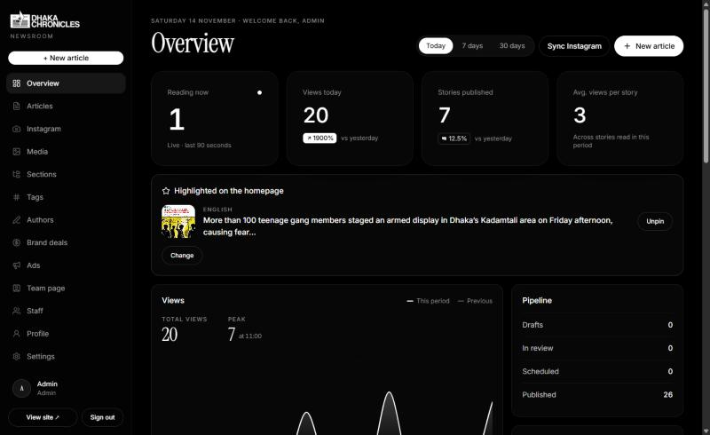

**Header:**
- Today's date and "Welcome back".
- **Today / 7 days / 30 days:** changes the period for every number on the page.
- **Sync Instagram:** checks @dhakachronicles for new posts now.
- **New article**.

**Stat cards:**

| Card | Meaning |
|---|---|
| **Reading now** | People on the site in the last 90 seconds (live) |
| **Views** (today / 7 days / 30 days) | Story views in the period, with the change against the previous period (e.g. ↗ 12% vs yesterday) |
| **Stories published** | Stories published in the period, with change |
| **Avg. views per story** | Views divided by the stories that were read |

**Highlighted on the homepage:** the story pinned as the homepage lead.
- **Change:** pick a different story from a list.
- **Unpin:** go back to automatic, where the newest featured story leads.

**Views chart:** a smooth line for the period, with a faint line for the previous period. It shows **total views** and the **peak** time. Hover anywhere on the line for the exact number at that time.

**Pipeline:** how many stories are drafts, in review, scheduled and published. Click a row to open that list.

**Instagram card:** connection status, imported, published and failed counts, the import mode, and the last sync time. Click it to open the Instagram page.

**Top articles:** the most-read stories of the period. Columns:
- **Now:** people reading it right now.
- **Views**.
- **Trend:** up or down against the previous period.

**By section:** views per section as bars, and a ring showing the **Bangla vs English** share of views.

**Team activity / Notifications:** the latest actions by everyone, with who did it and when. When there are unread notifications for you, they show here first, with **Mark read**.

## L. Articles: writing, review, publishing

### The article list

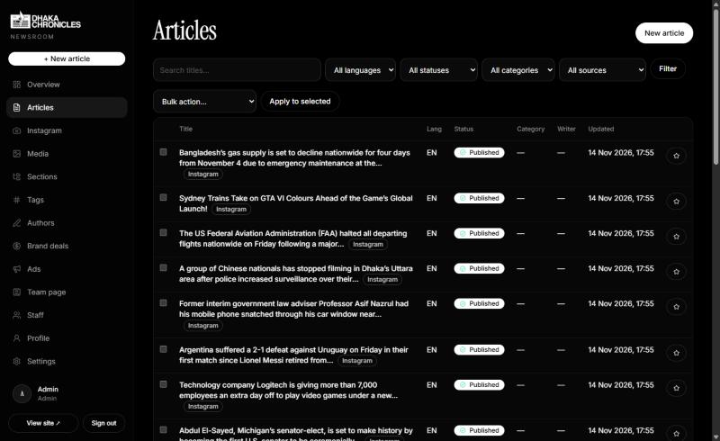

**Filters across the top:**
- **Search titles**
- **All languages** (English / Bangla)
- **All statuses** (draft, in review, scheduled, published, archived)
- **All categories** (section)
- **All sources** (written here / Instagram)

Then press **Filter**.

**Each row shows:**
- **Title.** An **Instagram** badge marks imported posts.
- **Lang:** EN or BN.
- **Status:** coloured badge.
- **Category** and **Writer**.
- **Updated:** the last change.
- **☆ star:** click it to **feature** or unfeature the story instantly.

**Bulk actions:**
1. Tick the boxes on the left.
2. Choose a **Bulk action**: publish, archive, return to draft, delete, feature or unfeature.
3. Press **Apply to selected**. A message says how many changed, and lists any that couldn't (for example, a writer can't publish).

### Writing and editing a story

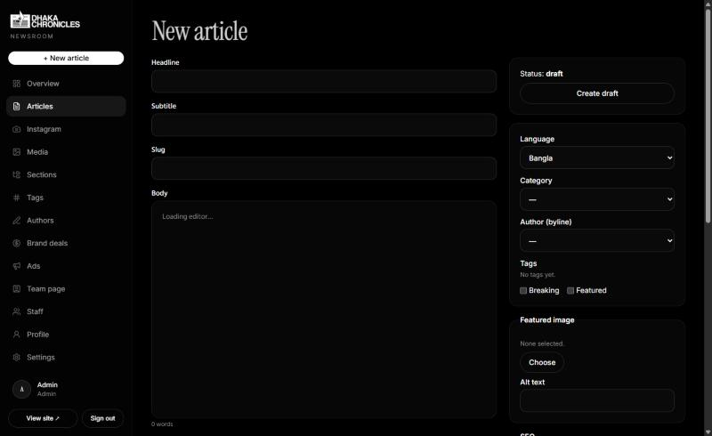

**Left column (the story):**
- **Headline.** Keep it under about 60 characters for Google.
- **Subtitle.** An optional second line.
- **Slug:** the web address. It fills in from the headline; English slugs use letters, numbers and dashes.
- **Body.** The toolbar has:

  | Button | Does |
  |---|---|
  | **P / H2 / H3** | Normal text, big heading, small heading |
  | **B / I** | Bold, italic |
  | **• List / 1. List** | Bulleted or numbered list |
  | **“ ”** | Quote |
  | **Link** | Turns selected text into a link |
  | **Image** | Inserts a photo from the media library (or uploads one) |
  | **Caption** | Adds a caption under a photo |
  | **Video** | Inserts a video from the media library |
  | **―** | Divider line |
  | **↶ ↷** | Undo / redo |

  The word count is shown under the body.
- **Excerpt:** the short summary used on cards and in Google. Left empty, it is made from the first lines.

**Right column:**
- **Status box:** the current status and the main action button. It changes with your role and the story's status:
  - Create draft, Save, Submit for review, Approve, Publish, Schedule, Unpublish, Archive or Restore.
  - **Schedule** asks for a date and time.
  - **Preview** opens the story exactly as readers will see it.
- **Details:**
  - **Language:** English or Bangla.
  - **Category** (section). Left empty, it is chosen automatically.
  - **Author (byline)**.
  - **Tags:** pick existing tags; more are added automatically.
  - **Breaking:** marks urgent news.
  - **Featured:** puts it in the homepage Featured column.
- **Featured image:**
  - **Choose** opens the media library to pick or upload the main photo.
  - **Alt text** describes the photo, for blind readers and Google.
- **SEO:**
  - **SEO title** (max 60 characters) and **Meta description** (max 160): what Google shows. Left empty, the headline and excerpt are used.
  - **Focus keyword:** the main phrase people will search for.
  - **Canonical URL:** only if the story was first published elsewhere.
  - **Open Graph title / description:** text for Facebook and WhatsApp previews.
  - **Live checklist** under the fields, e.g. "Title is short", "No featured image (needed for social sharing and Google News)". It checks quality only; it doesn't predict rankings.
  - **AI suggestions**, when an AI key is set up: fills in a suggested SEO title, description, keyword and excerpt for you to review.

**Further down on an existing story:**
- **Translations:** the linked version in the other language, or buttons to create it (see [M](#m-translation-english--bangla)).
- **Revisions:** earlier versions saved before big edits. **Restore** brings one back; the current text is saved first.
- **Info:** when the story was created, first published, last published, scheduled and submitted.
- **Original Instagram source:** for imported posts, the untouched caption, the original post date and a **View on Instagram** link.
- **Hold to delete permanently** (admins only): you must hold the button down.

### Statuses and who can do what

| Status | Meaning | Who can move it here |
|---|---|---|
| **Draft** | Being written, not public | Anyone with access to the story |
| **In review** | The writer is finished | Writers (Submit for review) |
| **Scheduled** | Publishes by itself at the chosen time (checked every minute) | Editors, admins |
| **Published** | Live on the site | Editors, admins |
| **Archived** | Taken off the site, kept for records | Editors, admins |

**When a story is published:**
1. It appears on the homepage, in its section, under its tags and author, in search, in Google's news sitemap and in the RSS feed, within seconds.
2. A message with the photo and links goes to the Discord **article log**.
3. Readers of the other edition see the language switch if a translation exists.

## M. Translation (English ↔ Bangla)

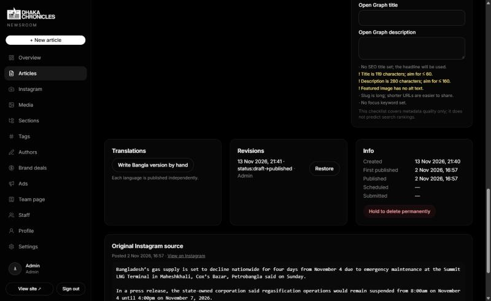

On any saved story, the **Translations** box offers:
- **Translate to Bangla automatically** (or "to English" on a Bangla story):
  1. The headline, subtitle, excerpt and every paragraph are translated in one go (about 10–60 seconds; the button shows "Translating…").
  2. A **new draft** opens in the other language, linked to the original.
  3. Formatting, photos, video, links, section and tags are kept.
- **Write Bangla version by hand:** opens an empty linked draft.

> **Setup needed:** automatic translation uses the same AI service as "AI suggestions". Under **Settings → Integrations** it currently says *AI SEO suggestions: Not set*, so the automatic button is hidden until a developer adds the AI key (`AI_SEO_API_URL`, `AI_SEO_API_KEY`, `AI_SEO_MODEL`). The hand-written option always works.
>
> Machine translation is a first draft. **Always read and correct it before publishing**, especially names, numbers and quotes.

## N. Instagram import

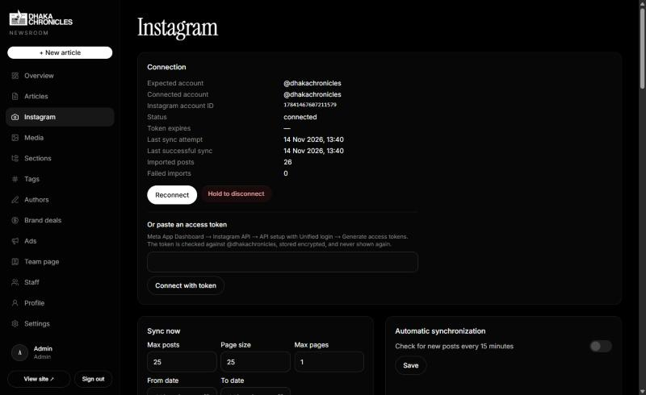

Only the **main admins** can change anything here. Editors can look.

### Connection

| Field | Meaning |
|---|---|
| Expected / Connected account | Must both be **@dhakachronicles**; any other account is refused |
| Status | connected, expired or error |
| Token expires | When Instagram's access runs out (it is renewed automatically) |
| Last sync attempt / Last successful sync | When the site last checked Instagram |
| Imported posts / Failed imports | Running totals |

**Buttons:**
- **Reconnect:** signs in to Instagram again. Use it if you get a "token expired" alert.
- **Hold to disconnect:** stops all imports. Hold it for about a second.
- **Or paste an access token:** the backup way to connect, using a token from the Meta developer dashboard. It is checked against @dhakachronicles and stored encrypted.

### Sync now

Checks Instagram immediately. Optional limits:
- **Max posts**, **Page size**, **Max pages**: how far back to look.
- **From date / To date**: only posts in this window.

Posts already on the site are skipped automatically.

### Automatic synchronization

- **Check for new posts every 15 minutes:** turn on and press **Save**.
- **When a new post appears:**
  - **Publish automatically:** goes live right away, with the caption as the story.
  - **Save as draft:** waits for an editor (safer).

  Discord is told either way.

### Automatic sections and tags

Every imported story is filed under the best-matching section and tagged from its caption. **Sort all stories now** does this for every story on the site, in case some were missed.

### Posts (tabs)

| Tab | Shows |
|---|---|
| **Imported** | Every imported post: date posted, type (image, video, carousel), caption, status, and **Open** (edit) / **Live** (view) links |
| **Needs approval** | Imported drafts. Tick them and press **Approve** to publish |
| **Failed** | Posts that couldn't be imported, with the reason. They retry automatically after 5 min, 20 min, 80 min…; **Retry** tries again now without reloading the page |
| **Pick from Instagram** | Your latest Instagram posts, with already-imported ones marked |

**Picking specific posts:**
1. Open **Pick from Instagram** and tick the posts you want.
2. Optionally choose a **section**.
3. Choose **Import as drafts** or **Import and publish**.

Each post is copied with its photos (all carousel images) and video, then:
- The headline is taken from the caption's first sentence; ALL-CAPS captions are tidied up.
- The full caption becomes the story, with a link back to the post.
- The original post date is kept.
- The language is detected, and a section and tags are added.
- Collaboration and paid-partnership posts get the **Sponsored** tag.

## O. Media library

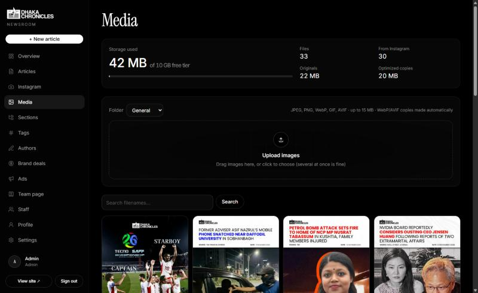

- **Upload:** drag files onto the page or click to choose. Photos (JPG, PNG, WebP, AVIF) and videos (MP4) are accepted. A progress bar shows each file.
- **Automatic optimisation:** each photo is turned into small **AVIF** and **WebP** copies in several widths, so readers on phones download only what they need.
- **Click a photo** to edit:
  - **alt text** in English and Bangla
  - **caption**
  - **credit** (who took it)
- **Search** by file name or caption; Instagram media is marked.
- **Delete** (hold the button). A photo still used in a published story can't be deleted; the message names why.

## P. Sections, tags and authors

### Sections

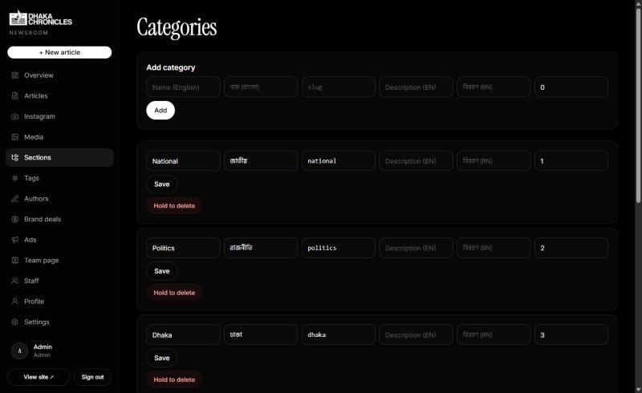

The page is titled **Categories**: the sections in the site menu.
- **Add category:**
  - Name (English), নাম (বাংলা), **slug** (web address, e.g. `national`), optional descriptions in both languages.
  - **Order number:** lower numbers come first in the menu.
  - Press **Add**.
- **Each section** can be edited in place, then **Save**. **Hold to delete** removes it; its stories stay, without a section.

Current sections: National, Politics, Dhaka, Business, Sports, Entertainment, International.

### Tags

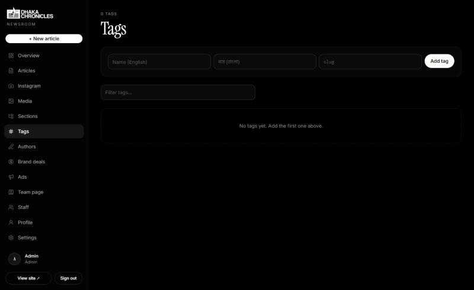

- **Add tag:** English name, Bangla name, slug, then **Add tag**.
- **Filter tags:** find one quickly.
- Each tag can be renamed or deleted.

Most tags are created automatically from names, places and hashtags in stories.

### Authors

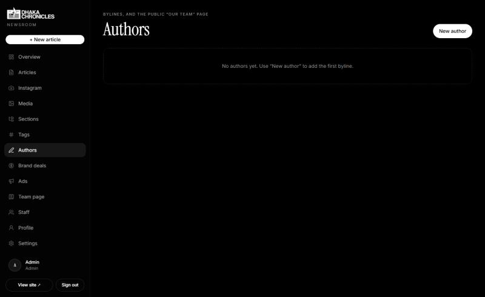

Authors are the **bylines** shown on stories.
- **New author:**
  - Name in English and Bangla, slug, bio in both languages, a public email (optional).
  - **Photo** upload.
  - **Linked staff account**, so that person's stories use this byline.
- The card shows how many stories each author has.

Instagram imports use the *@dhakachronicles on Instagram* byline instead.

## Q. Featured stories and the homepage highlight

**Featured column** on the homepage:
- **By hand:**
  - the **☆** star in the article list, or
  - **Featured** in the editor, or
  - **Bulk action → Feature**.
- **Automatically:** every sync, the week's top Instagram posts by **likes + 3 × comments** are featured. The site removes only the stories **it** featured, never ones an editor chose.

**Homepage highlight:** the single big lead story.
- On the **Overview**, press **Change** under "Highlighted on the homepage" and pick a story, or use the highlight button on a story.
- **Unpin** returns to automatic: the newest featured story, otherwise the newest story.

## R. Brand deals (your portfolio)

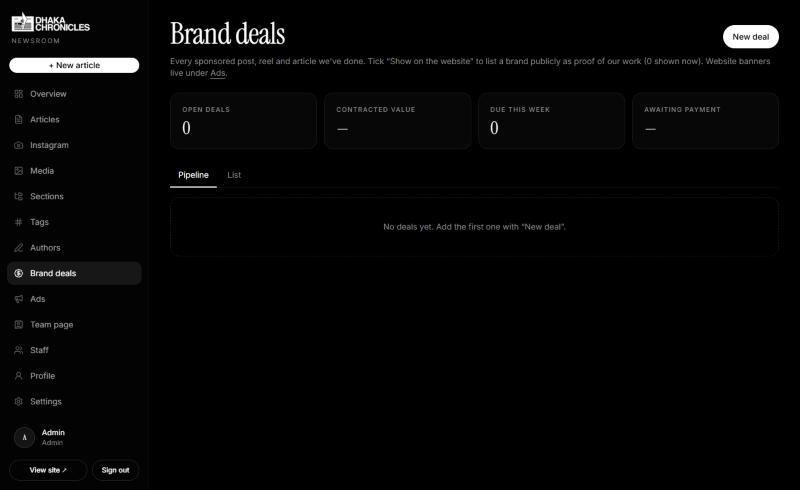

Brand deals is your private record of every paid partnership. It also decides which brands are shown publicly as proof of your work.

**Top cards:**

| Card | Meaning |
|---|---|
| Open deals | Not yet published or cancelled |
| Contracted value | Total fees of contracted, in-production and published deals |
| Due this week | Open deals due in the next 7 days |
| Awaiting payment | Invoiced but not paid |

**Views:**
- **Pipeline:** a board with columns Lead → Negotiating → Contracted → In production → Published. Each card shows the brand, deliverables, fee and due date, plus **Site** if the brand is shown publicly.
- **List:** a table with Brand, Deliverables, Stage, Fee, Due and Paid.

### New deal / editing a deal

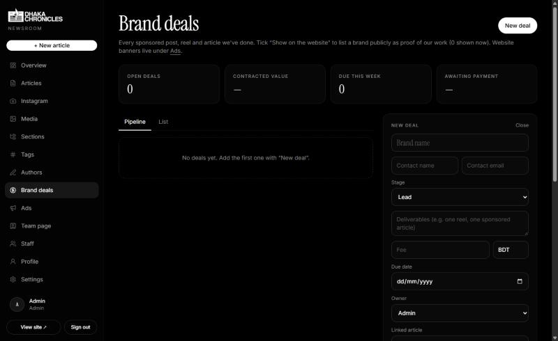

Press **New deal** or click any deal. The form opens on the right (at the top on phones).

| Field | Notes |
|---|---|
| Brand name | Required |
| Contact name / email | Staff only |
| Stage | Lead, Negotiating, Contracted, In production, Published, Cancelled |
| Deliverables | e.g. "1 reel + 1 sponsored article" |
| Fee + currency | Default BDT |
| Due date | Counts toward "Due this week" |
| Owner | Staff member in charge |
| Linked article | The sponsored story; it gets the **Sponsored** tag automatically |
| Checklist | Brief approved, Brand sign-off, Invoice sent, Paid. "Paid" needs "Invoice sent" first |
| Notes | Staff only |

**Show on the website (portfolio):**
1. Tick **Show in "Brands we've worked with"**.
2. **Brand logo:** click the square to upload. A transparent PNG looks best.
3. **What we did together:** one public line, e.g. "Eid launch reel".
4. **Proof link:** the Instagram post or reel (`https://…`).
5. **Brand website** (optional).

Then press **Save deal**. The brand appears on the **homepage** and the **Advertise** page within a minute. Fees, contacts and notes are **never** shown publicly. **Hold to delete deal** is for admins only.

## S. Ads (website banners)

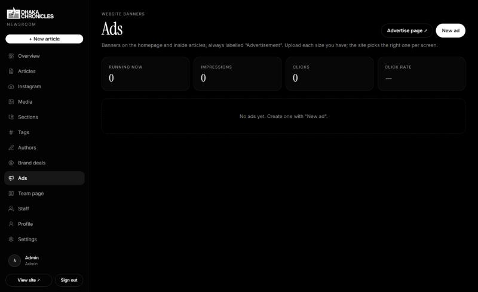

**Top cards:**
- **Running now**
- **Impressions:** times ads were seen.
- **Clicks**
- **Click rate:** clicks ÷ impressions.

Below is the list of ads. Each shows a thumbnail, its status, the advertiser, its placement, the end date, and its own views, clicks and rate.

| Status | Meaning |
|---|---|
| **Running** | Showing on the site now |
| **Scheduled** | Start date is in the future |
| **Ended** | End date has passed |
| **Paused** | "Running" is unticked |

### Creating an ad

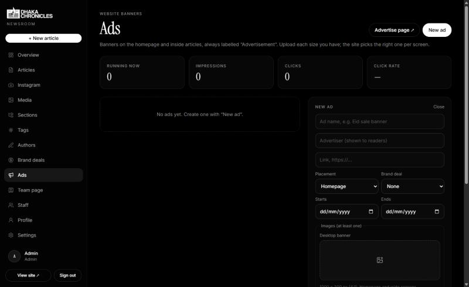

1. **Ad name:** for you, e.g. "Eid sale banner".
2. **Advertiser:** shown to readers.
3. **Link:** where clicks go. Must start with `https://`.
4. **Placement:** Homepage, Inside articles, or Homepage + articles.
5. **Brand deal:** optional link to the deal it belongs to.
6. **Starts / Ends:** the ad runs only between these dates (Dhaka time). Leave them empty for no limit.
7. **Images:** upload at least one; the site picks the right one for each screen:

   | Image | Size | Where |
   |---|---|---|
   | **Desktop banner** | 1200 × 300 px (4:1) | Homepage on computers and tablets |
   | **Phone banner** | 640 × 320 px (2:1) | Homepage on phones |
   | **Square** | 600 × 600 px | Inside stories |

   Click a box to upload; it shows "Uploading and optimising…" and then a preview. **Remove** clears it.
8. **Running:** untick to pause without deleting.
9. Press **Create ad**.

**Where ads appear:**
- **Homepage:** the first running ad sits under the lead stories, and a second one under "Brands we've worked with".
- **Stories:** the square ad sits under the story text.
- Every ad is labelled **Advertisement / বিজ্ঞাপন**.

**How numbers are counted:**
- **Impression:** at least half of the ad was on the reader's screen for one second.
- **Click:** the reader clicked through. Clicks are counted, then the reader is sent to the link.
- Repeated clicks from one connection are limited, so numbers can't easily be inflated.

### Report link for the advertiser

Open any ad. The box at the top shows its views, clicks and click rate, and a **private report link**:
1. Press **Copy** and send the link to the advertiser (email or WhatsApp).
2. They see a clean page with the ad's name, dates, **times seen, clicks, click rate**, a daily bar chart and a day-by-day table, updated live.

The link contains a long secret code, so only people you send it to can open it, and Google doesn't index it.

## T. Advertiser enquiries

When a business fills in the form on the public **Advertise** page:
1. A new deal appears in **Brand deals** at stage **Lead**:
   - Brand = their company; contact = their name and email.
   - Deliverables = what they're interested in.
   - Notes = phone, budget and message.
2. The Discord **activity** channel gets a message with the details and a link to the lead.
3. They see a thank-you message promising a reply within two working days.

Reply by email (dhakachronicles@gmail.com), Instagram or Facebook, then move the deal along the pipeline.

## U. Team page

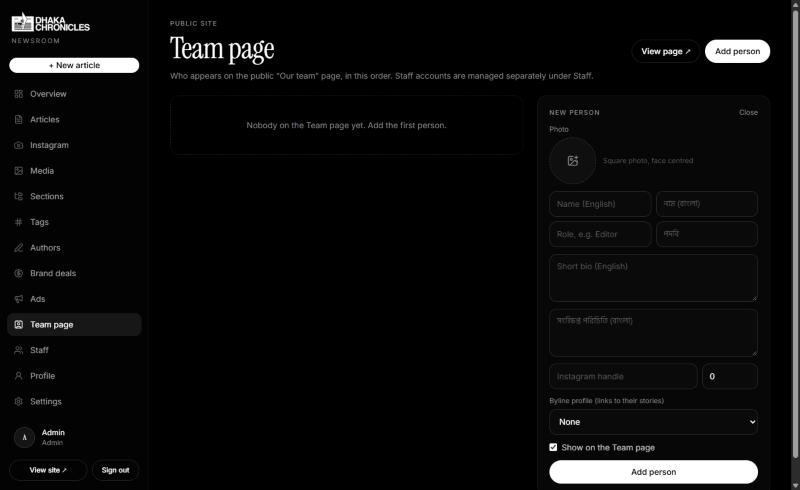

**Team page** (menu) controls who appears on the public **Our team** page. It is separate from staff accounts: you can list people who never sign in.
- **Add person:**
  - **Photo:** square, face centred.
  - **Name** and **role** in English and Bangla.
  - **Short bio** in English and Bangla.
  - **Instagram handle** (without @).
  - **Order number:** lower comes first.
  - **Byline profile:** links the card to their stories.
  - **Show on the Team page:** untick to hide someone temporarily.
- Press **Add person** / **Save person**. **Hold to remove from page** deletes the card.
- **View page ↗** opens the public page.

## V. Staff, roles and passwords

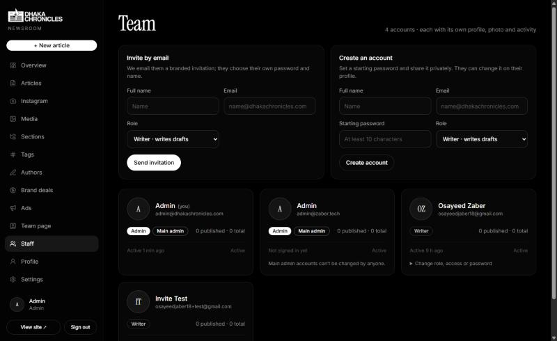

**Staff** (the page is titled "Team") lists every account that can sign in.

**Two ways to add someone:**
- **Invite by email:** full name, email and role, then **Send invitation**. They get a branded email and choose their own password.
- **Create an account:** full name, email, a **starting password** (at least 10 characters) and role, then **Create account**. Share the password privately; they can change it under Profile.

**Each person's card shows:**
- Photo, name and email.
- Role badge, plus **Main admin** where it applies.
- Stories published and total.
- When they were last active.

**Change role, access or password** opens their settings. Main admins can:
- change the role;
- turn access off;
- **reset the password**: this shows a temporary password once, which you pass on privately.

**Roles:**

| | Writer | Editor | Admin | Main admin |
|---|:-:|:-:|:-:|:-:|
| Write drafts, upload photos | ✓ | ✓ | ✓ | ✓ |
| Edit anyone's stories, publish, schedule | | ✓ | ✓ | ✓ |
| Sections, tags, authors, brand deals, ads | | ✓ | ✓ | ✓ |
| Delete stories, deals, ads | | | ✓ | ✓ |
| Team page, staff, settings | | | ✓ | ✓ |
| Instagram (connect, import, settings) | | | | ✓ |
| Reset passwords, change other staff | | | | ✓ |

The **main admins** are admin@dhakachronicles.com and admin@zaber.tech. Their accounts can't be changed or removed by anyone, including each other: their cards say *"Main admin accounts can't be changed by anyone."*

## W. Your profile

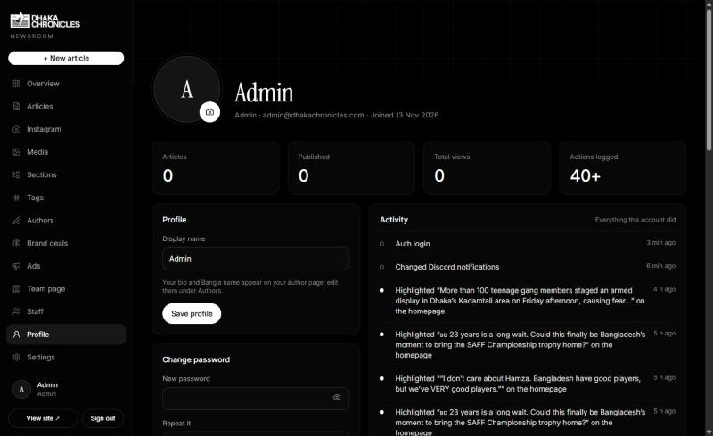

- **Photo:** click the camera to upload a new one.
- **Name, role, email, join date.**
- **Stats:**
  - **Articles:** stories you've written.
  - **Published:** how many are live.
  - **Total views** on your stories.
  - **Actions logged:** everything you've done in the newsroom.
- **Profile:** change your display name, then **Save profile**. Bios and Bangla names are edited under Authors.
- **Change password:** new password twice, with show/hide buttons.
- **Activity:** a timeline of everything this account did, e.g. "Highlighted … on the homepage" or "Changed Discord notifications".
- **On phones:** **View site** and **Sign out** buttons are at the bottom.

## X. Settings

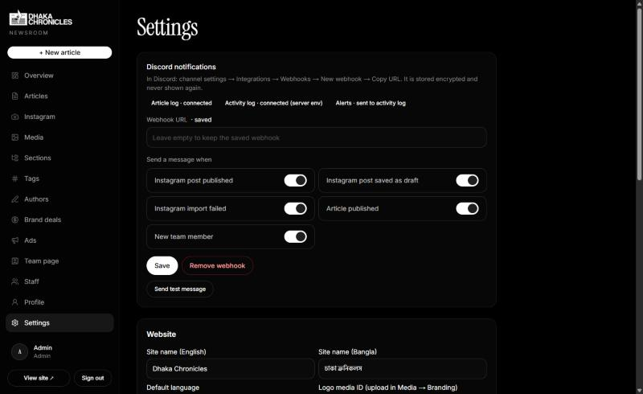

Admins only.

**Discord notifications:**
- **Channel status**, for example:
  - *Article log · connected*
  - *Activity log · connected (server env)*
  - *Alerts · sent to activity log* (no separate alerts channel yet)
- **Webhook URL:** paste a webhook from Discord (channel settings → Integrations → Webhooks → New webhook → Copy URL). It's stored encrypted and never shown again.
- **Send a message when:** switches for **Instagram post published**, **Instagram post saved as draft**, **Instagram import failed**, **Article published** and **New team member**.
- **Save**, **Remove webhook**, **Send test message**.

**Website:**
- **Site name** in English and Bangla.
- **Default language:** where the bare domain sends visitors.
- **Logo:** optional upload; the built-in logo is used when empty.
- **Social links:** Facebook, Instagram, X, YouTube. Instagram and Facebook are always shown, even if left empty here.
- **SEO defaults:** title suffix (e.g. " | Dhaka Chronicles") and default descriptions in both languages.
- **Save settings**.

**Integrations:** a read-only status of the services set up by the developer:
- Cloudflare R2 media storage
- Instagram API
- Supabase Cron secret
- AI SEO suggestions (also used for translation)

## Y. Discord notifications

| Channel | What arrives |
|---|---|
| **Article log** | Story published, scheduled or sent for review; Instagram imports. With photo, section, and links to the site, the editor and the Instagram post |
| **Activity log** | Every staff action: sign-ins, edits, invites, settings, deals, ads, team page, and **advertiser enquiries** |
| **Alerts** | Problems: failed imports, Instagram token issues, too many sign-in attempts, rate limits, and **reader error reports**. Until an alerts webhook is added, these go to the activity log |

All messages share one style. Many quick edits to the same story are grouped, so the channels stay readable.

## Z. Rules, tips and troubleshooting

**Built-in rules:**
- **Paid content:** always labelled **Sponsored** (stories) or **Advertisement** (banners).
- **Instagram:** imports publish only when you choose that.
- **Translations:** machine translations are drafts until a person publishes them.
- **Languages:** one story is one language; the other language is a separate, linked story.
- **Main admins:** can't be changed by anyone.

**Tips:**
- **Photos:** upload at least 1200 px wide. The site makes the small versions.
- **Alt text:** always fill it in.
- **Headlines:** under 60 characters for Google; the SEO checklist helps.
- **Scheduling:** schedule morning stories the night before.
- **Advertisers:** send the report link at the end of each week of a campaign.
- **Breaking news:** turn on **Breaking** and **Featured**, or pin it as the highlight.

**If something goes wrong:**

| Problem | What to do |
|---|---|
| A scheduled story didn't publish | Check its status; if it is still "Scheduled", tell the developer that the scheduled job may not be running |
| "Instagram token expired" alert | A main admin presses **Reconnect** on the Instagram page |
| An import failed | **Instagram → Failed → Retry** |
| An ad isn't showing | It must be **Running**, today must be within its dates, it needs an image, and the placement must match the page |
| No "Translate automatically" button | The AI key isn't set (Settings → Integrations); tell the developer |
| Can't sign in | Ask a main admin to reset your password |
| No Discord messages | **Settings → Discord → Send test message** |
| A photo can't be deleted | A published story uses it; remove it from that story first |

If you see an error you don't understand, copy the message and send it to the developer.
